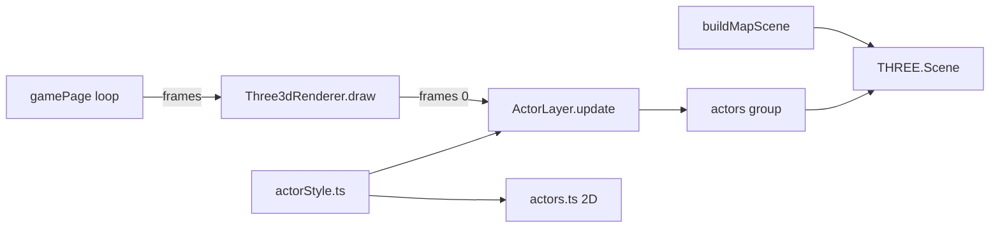

# Requirements

### Overview & Goals
Phase 5 of the optional 3D renderer: draw the dynamic part of a `FrameView` (player, enemies, downs, aim and view cones, tracers, spike with pulse and defuse ring) in three.js, so a full round can be played with `?3d=1`. The default 2D path must look exactly the same as now.

### Scope
**In scope**
- `web/src/render/actorStyle.ts`: actor constants shared by 2D and 3D. `actors.ts` imports them and its output stays identical.
- `web/src/render/three3d/actorScene.ts`: a pooled `ActorLayer`.
- Wiring it into `three3d.ts`: created once, survives `loadMap`, disposed on `destroy`.
- Tests: the new `actorScene.test.ts`, the all-vertices axis test in `mapScene.test.ts`, and `actorStyle.ts` added to the purity guard.
- `docs/3d-renderer.md`: update phase 4's "Still missing" line and add "Phase 5 — actors".

**Out of scope**
- Replay viewports (phase 6), shadows and quality tiers (phase 7), CHANGELOG (phase 8).
- CSP changes and new dependencies.
- Any change to `src/sim/`, `session.ts`, `frameView.ts` logic, scoring, kiosk, touch, level code, the probe or `gamePage.ts`. No wiring change is needed there: `gamePage.ts:845` already passes `[lastLive]` or `replay.frames()` to `renderer.draw`.

### Functional Requirements
- The layer draws only what the frame contains. Fog is already applied in `liveFrame`, so the layer has no visibility logic of its own.
- **Player:** body cylinder r 120, h 160, cyan; ground glow r 228 at α 0.1.
  - When `aim` is set and farther than `PLAYER_R` (the 2D `hasDir` rule): an aim cone (1100 long, half-angle 0.16, α 0.12), an aim line (α 0.35) and a nose triangle (tip R+90, base R+10, ±0.5 rad, `BODY_EDGE` colour).
- **Enemies:** body cylinder r 110, h 150, red; ground glow r 198 at α 0.12 (2D parity).
  - The view cone (520 long, half-angle 0.32, α 0.1) and the facing tick (length R+110, width 22, α 0.9) are shown only when `fx`/`fy` are defined and not both 0.
- **Downs:** a ground ring r 100 (width 10, α 0.3) plus an X (±70, width 22, α 0.55). Colour is cyan for the player side, red for enemies.
- **Tracers:** drawn from `shot.from` to `shot.to` at Y 120.
  - Halo: width 44, α 0.14·a. Core: width 12, α 0.9·a, where a = clamp(fade, 0, 1).
  - Colour: `0xc8f8ff` for `P0` shots, `0xff9a5c` for enemy shots.
  - On a hit, two discs at the hit point: r 150 white at α 0.18·a, and r 70 in the tracer colour at α 0.75·a.
- **Spike:**
  - Zone disc of radius `DEFUSE_RADIUS` (α 0.1) with an outline (width 12, α 0.7).
  - With `pulseT`: a pulse ring k = (pulseT % 1.2)/1.2 at radius R + 420k, α 0.45(1−k). Without it (reduced motion or replay): a still ring at R+200, α 0.25.
  - A hovering red octahedron (size 95) with amber edges.
  - When there is any defuse progress: a grey track ring (`surfaceHi`, α 0.85) at R+110, width 46, plus a progress arc that starts at 12 o'clock (world −y) and runs clockwise on screen. Green shows own defuse; red shows enemy defuse only when own defuse is 0.
- `update(null)` hides everything.
- Walls hide bodies, tracers and ground decals behind them.

### Non-Functional Requirements
- After construction, `update()` creates no geometries or materials; pools only toggle visibility and set transforms, opacity and colour.
- Entry chunk gzip grows by at most ~0.5 kB (expected ≈0, only an import moves). three stays in lazy chunks.
- Deterministic and pure. `actorStyle.ts` has no pixi, three, DOM or clocks.

# Technical Design

### Current Implementation
- `render/actors.ts` draws the 2D actors (constants on lines 14–24, `drawFrame` at :127). `PLAYER_COLOR`/`ENEMY_COLOR` are already exported and come from `ui/theme`.
- `three3d/three3d.ts:64`: `draw()` renders the static scene and ignores frames.
- `mapScene.ts` maps world (x, y) to (X = x, Y, Z = y). Its layers sit at Y 0–3 with renderOrder ≤ 5, and its lines use `depthWrite: false`.
- Timing: `liveFrame` already sets `pulseT = nowMs/1000` from the loop clock, and the tracer `fade` comes from the same `nowMs`. So the 3D layer reads `pulseT`/`fade` from the frame exactly as `drawSpike`/`drawTracer` do, and `nowMs` is not needed for parity.

### Key Decisions
1. **Shared style module.** `actorStyle.ts` exports `PLAYER_COLOR, ENEMY_COLOR, PLAYER_TRACER, ENEMY_TRACER, BODY_EDGE, PLAYER_R, ENEMY_R, AIM_LEN, AIM_HALF, VIEW_LEN, VIEW_HALF`. It imports only `ui/theme`.
   - `actors.ts` re-exports `PLAYER_COLOR`/`ENEMY_COLOR`, so existing importers keep working.
   - It carries one comment: the drawn view cone (520 cm, 0.32 rad) intentionally differs from the sim's `FOV_COS`/`VIEW_RANGE`, and visual parity with 2D wins.
2. **Unit geometry with per-instance transforms.**
   - Shared unit geometries are built once: a cylinder (base at Y 0), a disc, a thin ring, a cone fan (6 steps like 2D, pointing +X in the XZ plane), a strip (+X, length 1), a box (length 1 along X) for tracers, an octahedron, and a nose triangle.
   - Each instance sets `position`, `rotation.y`, `scale` and `visible`.
3. **Angle mapping.** World heading a = atan2(dy, dx) becomes `rotation.y = -a`.
   - Rotating about Y by θ maps local +X to (cos θ, 0, −sin θ). With θ = −a that is (cos a, 0, sin a), which is world (cos a, sin a), because world +y = +Z.
   - A test checks this on its own (facing (0, 1) means local +X lands on +Z).
4. **Flat geometry plane.** Circle and ring geometries are built in XY and rotated by `+π/2` about X, which maps (x, y, 0) to (x, 0, y). This keeps the world angle (no mirror), so the progress ring's angles match world angles. Flat materials use `side: DoubleSide`.
5. **Progress ring.**
   - A pre-built `RingGeometry(r−23, r+23, 64, 1, −π/2, 2π)` with r = DEFUSE_RADIUS+110.
   - Theta grows with the world angle, which on screen (y down) is clockwise from 12 o'clock.
   - Progress is `setDrawRange(0, 6 · round(clamp(frac) · 64))`; with `phiSegments = 1` each theta segment is 6 indices.
   - Two meshes (green, red) instead of material swapping, so every resource stays attached to the group.
6. **Pulse ring keeps a constant 16 width.** It is a pre-built `RingGeometry` whose inner and outer vertex rows are rewritten in place each frame (`needsUpdate = true`). Nothing is allocated, and unlike scaling it does not widen the stroke.
7. **Layering.**
   - Decals are transparent, `depthWrite: false`, `depthTest: true` (walls hide them).
   - Heights follow the 2D draw order inside Y 4–6: spike 4.0–4.4, downs 4.8, enemy glow/cone/tick 5.0–5.4, player glow/cone/line/nose 5.6–6.0.
   - renderOrder: spike 6, downs/enemies 7, player 8 (map ≤ 5).
   - Bodies and the octahedron are opaque `MeshLambertMaterial` (lit by the map's lights) with a normal depth test and write.
   - Tracers are transparent boxes with depthTest on and depthWrite off, renderOrder 9.
   - The 2D z-merge of downs and enemies is dropped: in 3D, depth handles overlap.
8. **Pools.**
   - Sizes: enemies 5, downs 6, tracers 24, each grown on demand. Growing is the only allocation path and happens only past the current maximum.
   - Constant-alpha kinds share materials.
   - Every tracer slot owns 4 materials (halo, core, hit outer, hit inner). Opacity and `color.setHex` are set per update.
   - The spike pulse ring has its own material.
   - Every geometry and material is registered in a `Set` at creation, and `dispose()` frees that set.

### Data Models / Contracts
```ts
// web/src/render/three3d/actorScene.ts
export const DECAL_Y = { spike: 4, down: 4.8, enemy: 5, player: 5.6 } as const;
export const TRACER_Y = 120;
export class ActorLayer {
  readonly group: THREE.Group; // name "actors"
  update(frame: FrameView | null, _nowMs: number): void; // nowMs reserved; pulse/fade come from the frame
  dispose(): void;
}
```
Named children support the tests: `player-body`, `player-glow`, `player-aim-cone`, `player-aim-line`, `player-nose`, `enemy-body`, `enemy-glow`, `enemy-cone`, `enemy-tick`, `down-ring`, `down-x`, `tracer-halo`, `tracer-core`, `tracer-hit-outer`, `tracer-hit-inner`, `spike-zone`, `spike-outline`, `spike-pulse`, `spike-still`, `spike-diamond`, `spike-track`, `spike-progress-own`, `spike-progress-enemy`. Enemies, downs and tracers each sit in one sub-group per slot.

`three3d.ts` changes:
```ts
private readonly actors = new ActorLayer(); // ctor: this.scene.add(this.actors.group)
draw(frames) { this.actors.update(frames[0] ?? null, performance.now()); this.renderer.render(...); }
destroy() { dropMap(); scene.remove(actors.group); actors.dispose(); renderer.dispose(); ... }
// loadMap/dropMap untouched -> layer survives map changes
```

### File Structure
- `web/src/render/actorStyle.ts` (new)
- `web/src/render/actors.ts` (imports constants, otherwise unchanged)
- `web/src/render/three3d/actorScene.ts` (new)
- `web/src/render/three3d/three3d.ts` (wiring, updated doc comment)
- `web/tests/actorScene.test.ts` (new)
- `web/tests/mapScene.test.ts`, `web/tests/frameView.test.ts` (guards)
- `docs/3d-renderer.md`

### Architecture Diagram


### Risks
- **Ring winding and side:** after the +π/2 X rotation the normals point down, which `DoubleSide` handles. Tests assert the vertex positions of the drawn range.
- **Pool overflow** (many tracers): it grows instead of dropping, so allocation can happen only at a new maximum. Documented.
- **Lambert bodies look slightly lighter or darker** than the flat 2D colour. Noted as a parity difference, like the walls in phase 4.
- **1 px WebGL lines:** avoided by using meshes (strips and boxes) for all widths.

# Testing

### Validation Approach
Unit tests run in vitest without WebGL (scene graph only), alongside the existing guards. The game itself is checked with Playwright headless Chromium at 1280x800 against `pnpm dev` on port 5177.

### Test Changes
`web/tests/actorScene.test.ts`, using hand-built `FrameView`s:
- **Visible counts:** 1 player, N enemies, M downs, K tracers, spike or no spike.
- **Positions:** world (x, y) lands at (x, *, y).
- **Heading:** facing (0, 1) on the enemy cone/tick makes local +X, under the world matrix, point to +Z. The check uses `Vector3.applyQuaternion`, not camMath. A second check covers the aim (1, 0) toward +X.
- **Enemy cone and tick** are hidden when fx = fy = 0 or undefined.
- **Player aim cone** is hidden when `aim` is null or within `PLAYER_R`.
- **Tracer core opacity** = 0.9·clamp(fade) for fade −0.5, 0.4 and 1.3. Hit discs are shown only when `hit`.
- **Spike progress:**
  - 0.5 gives `drawRange.count` = half of the index count.
  - The first drawn vertex is at world angle −π/2, and the angle increases along the range.
  - Own defuse uses green with the enemy ring hidden. Enemy defuse uses red. Neither shows the track.
  - With `pulseT` null the still ring is shown; with a value the pulse ring is at radius R+420k.
- **Ground decals** sit at 4 ≤ Y ≤ 6, `depthWrite: false`, renderOrder > 5. Bodies use `depthTest` and `depthWrite` true.
- **Hiding:** `update(null)` leaves no visible meshes.
- **No allocation:** 50 updates with changing frames, each within the pool sizes, create nothing new. This is checked two ways: probe `new BufferGeometry().id` and `new MeshBasicMaterial().id` before and after (the id gap is 1), and the set of geometry/material uuids in the group is unchanged.
- **Disposal:** `dispose()` calls dispose on every geometry and material in the group (spies).

Other test files:
- `mapScene.test.ts`: the axis test iterates every vertex of every wall polygon. Each must have a geometry vertex at (x, *, y) and none at (x, *, −y) unless that equals a real vertex. Every geometry vertex's (X, Z) must be one of the polygon's points.
- `frameView.test.ts`: add `../src/render/actorStyle.ts` to the full purity glob (file count 3 → 4).
- `three-lazy.test.ts` stays as it is and keeps passing (`actorStyle.ts` does not import three; `actorScene.ts` is under `three3d/`).

### Key Scenarios
- `npx tsc --noEmit`, `pnpm test` and `pnpm build:public` (expect `verify-dist: OK`). Report the entry and three3d chunk sizes (raw and gzip −9).
- `/?auto&seed=42` (2D): the score card reads 500 points, 3.7 s / 6.0 s, 2/3 kills.
- `/?3d=1&auto&seed=42`: the same score card with no console errors. Take mid-round screenshots (for example around ticks 40 and 80) showing the aim cone, an enemy view cone, a tracer and the spike ring. Read `?fps`.
- Manual check in 3D: the body sits under the aim line, the cones point the same way as in a 2D screenshot at the same tick, and walls hide enemies standing behind them.

### Edge Cases
- A dead player in the YOU replay gives `player: null` plus a player-side down.
- Reduced motion (`pulseT: null`) shows the still ring.
- `enemyDefuse` undefined.
- Fade above 1 or below 0.
- A frame with more tracers than the pool size grows the pool without errors.
- `loadMap` twice keeps the actor group in the scene.

# Delivery Steps

### ✓ Step 1: Extract shared actor style
2D and 3D read the same actor constants from a new pure module, and the 2D output is unchanged.
- Create `web/src/render/actorStyle.ts` with `PLAYER_COLOR, ENEMY_COLOR, PLAYER_TRACER, ENEMY_TRACER, BODY_EDGE, PLAYER_R, ENEMY_R, AIM_LEN, AIM_HALF, VIEW_LEN, VIEW_HALF`. It imports only `ui/theme`.
- Add the cone-parity comment (drawn cone vs `FOV_COS`/`VIEW_RANGE`).
- `actors.ts` imports the constants and re-exports `PLAYER_COLOR`/`ENEMY_COLOR`; no drawing code changes.
- Add `actorStyle.ts` to the full purity glob in `web/tests/frameView.test.ts` (count 4).
- Run `tsc` and `pnpm test`.

### ✓ Step 2: Build pooled ActorLayer with unit tests
`web/src/render/three3d/actorScene.ts` draws a whole FrameView from pooled meshes, and its behaviour is covered by tests.
- Shared unit geometries: cylinder, disc, thin ring, 6-step cone fan, strip, box, octahedron, nose triangle. All are registered for disposal.
- Shared and per-slot materials:
  - decals: transparent, `depthWrite: false`, Y 4–6, renderOrder 6–8;
  - bodies: Lambert;
  - tracers: depth-tested, renderOrder 9.
- Player, enemy, down and tracer pools (5 / 6 / 24, grown on demand) and the spike set.
- Spike pieces:
  - zone and outline;
  - in-place pulse ring;
  - still ring;
  - octahedron with amber edges;
  - track ring;
  - own and enemy progress meshes on a `RingGeometry(…, 64, 1, −π/2, 2π)` with `setDrawRange`.
- Angle mapping `rotation.y = -atan2(dy, dx)`; 2D visibility rules (`hasDir`, facing non-zero).
- `update(null)` hides everything; `dispose()` frees the registry.
- Add `web/tests/actorScene.test.ts` with all the listed scenarios: counts, axis, heading sign, cone hiding, tracer opacity, drawRange half, colours, decal layering, no-allocation id/uuid check, dispose spies.

### ✓ Step 3: Wire the layer into Three3dRenderer and harden the map axis test
A round plays fully with `?3d=1`, and the map axis test covers every wall vertex.
- `three3d.ts`:
  - create one `ActorLayer` and add its group to the scene in the constructor;
  - `draw()` calls `actors.update(frames[0] ?? null, performance.now())` and then renders;
  - `loadMap` leaves the layer alone;
  - `destroy` removes and disposes it;
  - update the class doc comment.
- No changes to `gamePage.ts`, `frameView.ts` or the sim.
- `web/tests/mapScene.test.ts`: the axis test iterates every vertex of every wall (polygon points appear at (x, *, y), and every geometry X/Z is a polygon point).
- Run `npx tsc --noEmit`, `pnpm test` and `pnpm build:public` (`verify-dist: OK`). Record the entry, three3d and three chunk sizes (raw and gzip −9) and compare the entry against the phase 4 figures.

### ✓ Step 4: Browser parity checks and phase 5 docs
The 2D and 3D runs are verified in headless Chromium, and `docs/3d-renderer.md` describes phase 5.
- Playwright with headless Chromium at 1280x800 against `pnpm dev` (5177):
  - `/?auto&seed=42` gives a score card of 500 points, 3.7 s / 6.0 s, 2/3 kills;
  - `/?3d=1&auto&seed=42` gives the same card with no console errors;
  - take mid-round screenshots showing the aim cone, enemy cone, a tracer and the spike ring, plus a 2D screenshot at the same tick for cone direction;
  - check wall occlusion of enemies;
  - read `?fps` in 3D.
- `docs/3d-renderer.md`:
  - replace phase 4's "Still missing" line;
  - append "Phase 5 — actors": layer heights and renderOrder, the pooling rule, the angle mapping and its derivation, the progress ring drawRange, the cone parity note, the parity differences (Lambert bodies, no z-merge), chunk sizes, check results, and what is still missing (replay viewports, shadows, quality tiers).
- No CHANGELOG entry and no commit.