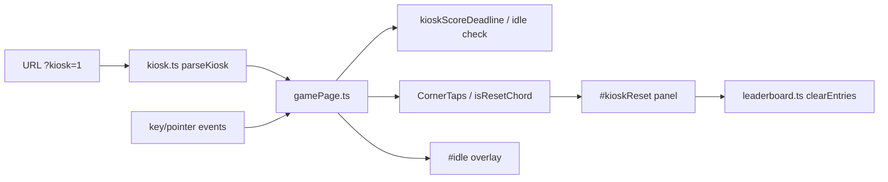

# Requirements

### Overview & Goals
Add a booth-friendly **kiosk mode**, turned on with `?kiosk=1`. The game cycles unattended between players: a finished run returns to the level select, an idle level select shows an attract loop, the download button and incoming challenge links are disabled, and the operator gets a hidden way to wipe the local leaderboard. **Gameplay rules are not touched**: no changes to the sim, scoring, round timing or the level contract.

### Scope
**In scope**
- Parsing the `?kiosk=1` flag (plus an optional `?idle=<s>` override for the attract delay).
- An inactivity-based return from the score screen once initials are saved or skipped.
- A new idle attract overlay that appears after the level select has been untouched for a while.
- Hiding "Download card" and ignoring `#c=` challenge links. **The QR code stays** so visitors can scan it.
- An operator leaderboard reset: a key chord **or** corner taps, then an in-page confirm.
- Unit tests and a `CHANGELOG.md` entry.

**Out of scope**
- Any change to the sim, scoring, `COUNTDOWN_S` or the play guard.
- Behaviour without `?kiosk=1`, which stays exactly as it is today.
- Fullscreen or OS-level kiosk lockdown.
- Deploying.

### User Stories
- As a booth visitor, I want the game to be on the level select when I walk up, so I can start right away.
- As a passer-by, I want an eye-catching attract screen, so I notice the booth.
- As the booth operator, I want to clear the scoreboard between sessions without players finding the control.
- As the operator, I don't want visitors downloading files or opening challenge links on the booth machine.

### Functional Requirements
1. **Flag**
   - Kiosk mode is on only when `kiosk=1`. Anything else, or a missing flag, means normal mode.
   - `idle=<s>` overrides the attract delay. It is clamped to 10–600 s; the default is 60 s.
2. **Score screen return (kiosk only)**
   - Before initials are saved or skipped, today's behaviour stays: a fixed 15 s auto-return.
   - Once the score is saved (Save button or Enter), the screen returns to the level select after **15 s with no input**.
   - Any key, pointer or wheel input restarts that 15 s.
   - A hard cap of 60 s from when the score screen first appeared always applies.
   - The replay screen keeps its existing pause and 45 s cap.
   - Enter with an empty box (skip) and "Next player" return immediately, as today.
3. **Idle attract screen (kiosk only)**
   - After 60 s (or `idle`) with no input on the level select, a full-screen `#idle` overlay appears.
   - It shows the title, the featured round titles and blurbs cycling every 4 s, the top 5 scores, and "Press any key or click to play".
   - The first key or click only dismisses it and returns to the level select. It never starts a level, and the input does not pass through.
   - Only original map names and titles are shown. No internal keys and no Riot assets.
4. **External links (kiosk only)**
   - `#downloadCard` is hidden and its handler does nothing.
   - `#c=…` hashes, both on load and on `hashchange`, are ignored, so the challenge panel never appears.
   - The QR code and "Scan to challenge a friend" stay.
5. **Operator reset (kiosk only, on the level select or idle screen)**
   - Triggers:
     - pressing `Ctrl+Shift+Alt+R`, or
     - 5 clicks or taps inside the 48×48 px top-left corner within 3 s.
   - Either trigger opens an in-page confirm panel: "Clear all local scores?" with **Clear** and **Cancel**.
   - The panel cancels itself after 10 s or on Esc.
   - Clear empties the leaderboard and re-renders the board with a short "Scores cleared" status.
   - Nothing about this is visible to players before it is triggered.

### Non-Functional Requirements
- Simulation determinism is unaffected. Kiosk code lives outside `src/sim/`.
- No CSP changes. No inline scripts or `eval`.
- All UI copy is in English.

# Technical Design

### Current Implementation
- `web/src/game/gamePage.ts` `startGame()` owns all screens (`Screen` = `attract | play | score | replay` in `input.ts`).
- The `#attract` overlay in `web/index.html` is the **level select**.
- Navigation helpers: `show()`, `toAttract()`, `toScore()`, `backToScore()`.
- The score screen uses a fixed `scoreDeadline = now + SCORE_RETURN_S` (`timing.ts`), checked in the ticker loop.
- `readHash()` and the `hashchange` listener feed the challenge panel.
- `leaderboard.ts` keeps entries in localStorage key `rtr.leaderboard.v1` through an injectable `KeyValueStore` (`getItem`/`setItem`).
- Project pattern: pure logic in small modules (`input.ts`, `challengeLanding.ts`, `timing.ts`) unit-tested in `web/tests/`, with `gamePage.ts` doing the DOM wiring.

### Key Decisions
- **Pure `kiosk.ts` module plus thin wiring in `gamePage.ts`.** This matches the `challengeLanding.ts` pattern, keeps the logic testable without a DOM, and lets every kiosk branch sit behind `if (kiosk)`, so normal mode is byte-for-byte the same behaviour.
- **Time is injected (`nowMs`)** into the idle and tap helpers, so tests don't need fake timers.
- **The idle attract is a new `Screen` value `"idle"`.** `show()` already toggles overlays by screen, and `blocksDefault` stays unchanged because it only blocks on play and replay.
- **The reset uses an in-page confirm, not `window.confirm`.** Kiosk browsers often suppress native dialogs.
- **`clearEntries` writes `"[]"` via `setItem`.** The `KeyValueStore` type and existing test fakes stay unchanged.

### Data Models / Contracts
```ts
// web/src/game/kiosk.ts
export const KIOSK_SCORE_IDLE_S = 15;   // after initials saved
export const KIOSK_SCORE_CAP_S = 60;    // hard cap on score screen
export const KIOSK_ATTRACT_IDLE_S = 60; // default, ?idle= overrides (10..600)
export const RESET_TAPS = 5, RESET_TAP_WINDOW_MS = 3000, RESET_CORNER_PX = 48;
export const RESET_CONFIRM_S = 10, ATTRACT_CYCLE_S = 4;

export type KioskConfig = { enabled: boolean; attractIdleS: number };
export function parseKiosk(search: string): KioskConfig;

/** Score-screen deadline in kiosk mode (ms, performance.now clock). */
export function kioskScoreDeadline(o: { shownAtMs: number; savedAtMs: number | null; lastActivityMs: number }): number;
// saved ? min(shown+CAP, max(savedAt,lastActivity)+SCORE_IDLE) : shown+SCORE_RETURN_S

export function isResetChord(e: Pick<KeyboardEvent, "code" | "ctrlKey" | "shiftKey" | "altKey">): boolean;

export class CornerTaps { // returns true on the tap that completes the gesture, then resets
  tap(x: number, y: number, nowMs: number): boolean;
}

export function attractSlide(nowMs: number, count: number): number; // index cycling every ATTRACT_CYCLE_S
```
```ts
// web/src/game/leaderboard.ts
export function clearEntries(store?: KeyValueStore | null): boolean; // setItem(KEY, "[]"), false on failure
```
```ts
// web/src/game/input.ts
export type Screen = "attract" | "idle" | "play" | "score" | "replay";
```

### Proposed Changes
- **`gamePage.ts`**
  - Read `const kiosk = parseKiosk(location.search)`.
  - Track `lastActivityMs`, updated on `keydown`, `pointerdown`, `pointermove` and `wheel` (window listeners), and `savedAtMs`, set in `saveScore()`.
  - In the ticker:
    - on the score screen, use `kioskScoreDeadline()` instead of the fixed deadline when kiosk mode is on;
    - on the level select, move to `"idle"` once `now - lastActivityMs > attractIdleS`;
    - while idle, rotate the slide via `attractSlide()`.
  - The idle screen dismisses on the first keydown or pointerdown, swallowing the event, then calls `toAttract()`.
  - The global keydown handler checks `screen === "idle"` first, so a digit or Enter doesn't start a level.
  - Skip `readHash()` and ignore `hashchange` when kiosk mode is on.
  - Hide `#downloadCard`.
  - Reset wiring:
    - `isResetChord` on keydown, and `CornerTaps` on `pointerdown` in `#attract`/`#idle`, both while on the level select or idle screen;
    - either opens the `#kioskReset` panel, which has a 10 s auto-cancel;
    - Clear calls `clearEntries()` and then `renderBoard()`.
  - Add `kiosk` and `idle` info to the dev-only `__rtr` probe.
- **`index.html`**
  - Add the `#idle` overlay (title, `#idleSlide`, `#idleBoard`, prompt).
  - Add the `#kioskReset` panel (hidden) with `#kioskResetClear` and `#kioskResetCancel` buttons and a `role=status` message.
  - Add minimal CSS, reusing `.overlay`.
- **`CHANGELOG.md`**: add an English "Added" entry. The guidelines require English, even though older entries are in Indonesian.

### File Structure
- Added: `web/src/game/kiosk.ts`, `web/tests/kiosk.test.ts`
- Modified: `web/src/game/gamePage.ts`, `web/src/game/input.ts`, `web/src/game/leaderboard.ts`, `web/index.html`, `CHANGELOG.md`

### Architecture Diagram


### Risks
- **3-minute session rule**: unattended worst case on the score screen stays at 15 s, so `sessionBudgetS` is unchanged. Activity after saving can stretch the screen to at most 60 s, but only while someone is actually present.
- **Stray input**: `pointermove` from a jittery mouse could keep the booth from ever going idle. Mitigation: ignore moves under 4 px.
- **Key collisions**: the chord is checked before the level shortcuts, so `R` never collides with gameplay keys. The chord is also ignored while play is running.

# Testing

### Validation Approach
Unit-test the pure kiosk logic and `clearEntries` with vitest, using injected time and a fake `KeyValueStore`, the same way `game.test.ts` does for the leaderboard. Then run the full suite and the type check. If a dev server can be started, do an optional manual browser check with `pnpm -C web dev` and `?kiosk=1&idle=10`.

### Test Changes (`web/tests/kiosk.test.ts`)
- `parseKiosk`:
  - `?kiosk=1` → enabled;
  - missing flag, `kiosk=0` or `kiosk=yes` → disabled;
  - `idle` defaults to 60;
  - `idle` is clamped to 10..600, and non-numeric values fall back to the default.
- `kioskScoreDeadline`:
  - unsaved → `shown + SCORE_RETURN_S`;
  - saved → `lastActivity + 15 s`;
  - activity extends the deadline but never past `shown + 60 s`;
  - activity before the save time is ignored.
- `isResetChord`: only Ctrl+Shift+Alt+`KeyR` matches; missing modifiers and other keys don't.
- `CornerTaps`:
  - 5 taps in the corner within 3 s → true on the 5th;
  - a tap outside the corner resets the count;
  - a gap over 3 s resets the count;
  - after a trigger, a fresh 5 taps are needed.
- `attractSlide`: cycles every 4 s and wraps around the count.
- `clearEntries`:
  - after adding entries, `topEntries()` is empty;
  - a null store or a throwing `setItem` returns false.

### Regression
- Existing tests (`timing`, `blocksDefault` and leaderboard) still pass unchanged, which confirms that gameplay and timing rules are untouched.
- Commands: `cd web && pnpm test`, `cd web && npx tsc --noEmit`. The ETL is untouched.

# Delivery Steps

### ✓ Step 1: Add pure kiosk logic and leaderboard reset with tests
`kiosk.ts` and `clearEntries` exist and are fully unit-tested, with no UI wiring yet.

- Create `web/src/game/kiosk.ts` with these constants:
  - `KIOSK_SCORE_IDLE_S`
  - `KIOSK_SCORE_CAP_S`
  - `KIOSK_ATTRACT_IDLE_S`
  - the `RESET_*` constants
  - `ATTRACT_CYCLE_S`
- Add these helpers to `kiosk.ts`:
  - `parseKiosk`
  - `kioskScoreDeadline`
  - `isResetChord`
  - `CornerTaps`
  - `attractSlide`
- Add `clearEntries()` to `web/src/game/leaderboard.ts`; it writes `"[]"` via `setItem` and returns false on failure.
- Extend `Screen` in `web/src/game/input.ts` with `"idle"`.
- Add `web/tests/kiosk.test.ts` covering all of the scenarios in the Testing tab.
- Run `pnpm test` and `npx tsc --noEmit`.

### ✓ Step 2: Wire kiosk flag, score-screen inactivity return and external-link hiding
With `?kiosk=1`, the score screen returns after 15 s idle once initials are saved, Download card is hidden, and `#c=` links are ignored.

- In `gamePage.ts`, parse `kiosk` once.
- Track `lastActivityMs` from key, pointer and wheel events, ignoring pointer moves under 4 px.
- Track `savedAtMs` in `saveScore()`.
- Use `kioskScoreDeadline()` in the score branch of the ticker; `backToScore` resets `shownAtMs` the same way it resets today's timer.
- Hide `#downloadCard`, and skip `readHash()` and `hashchange` in kiosk mode.
- Keep every non-kiosk path unchanged.
- Add the kiosk state to the dev-only `__rtr` probe.

### ✓ Step 3: Add idle attract screen
After the configured idle time on the level select, kiosk mode shows a cycling attract overlay that the first input dismisses back to the level select.

- Add the `#idle` overlay markup and CSS to `web/index.html`: title, `#idleSlide`, `#idleBoard` and the prompt text.
- Extend `show()` for `"idle"`.
- In the ticker, move from the level select to idle once the idle threshold passes, and rotate featured titles and blurbs with `attractSlide()`.
- Render the top 5 scores into `#idleBoard`, reusing the `renderBoard` row logic.
- Dismiss the overlay on the first keydown or pointerdown, swallowing the event, and handle the idle screen before the level shortcuts so it never starts a level.

### ✓ Step 4: Add hidden operator leaderboard reset and changelog
The operator can clear local scores via Ctrl+Shift+Alt+R or 5 corner taps, followed by an in-page confirm.

- Add the hidden `#kioskReset` panel to `index.html`, with Clear and Cancel buttons and a status line.
- In `gamePage.ts`, trigger the panel with `isResetChord` on keydown and with `CornerTaps` on pointerdown, both only on the level select or idle screen.
- The panel auto-cancels after 10 s or on Esc.
- Clear calls `clearEntries()`, calls `renderBoard()` and shows "Scores cleared".
- Add an English entry to `CHANGELOG.md` under Unreleased / Added.
- Re-run `pnpm test` and `npx tsc --noEmit`.