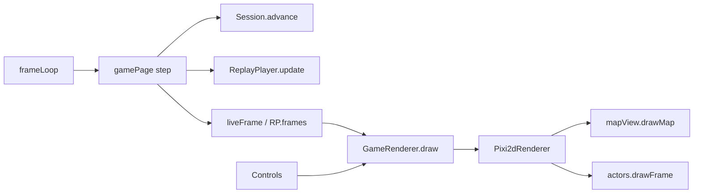

# Requirements

### Overview & Goals
Phase 2 of the optional 3D renderer. All Pixi code for the game moves behind `GameRenderer` (`web/src/render/renderer.ts`). Our own `requestAnimationFrame` loop drives both live play and the replay; the Pixi ticker no longer does. `ReplayView` becomes a renderer-agnostic `ReplayPlayer`. **Nothing visible or behavioural changes**: same colours, sizes, HiDPI cap, fog, tracers, replay headers, timings and score.

### Scope
**In scope**
- New `web/src/game/frameLoop.ts`, `web/src/render/pixi2d.ts` and `web/src/game/replayPlayer.ts`.
- Delete `web/src/game/replayView.ts`.
- Rewire `web/src/game/gamePage.ts` (it no longer imports `pixi.js`).
- New tests, plus extended purity and import guards.
- New "Phase 2 — renderer seam" section in `docs/3d-renderer.md`, with a parity table.

**Out of scope (unchanged)**
- `web/src/sim/`, `session.ts`, scoring, kiosk logic, touch controls logic, level code, `render/three3d/`, `input.ts`.
- `main.ts` (keeps `import "pixi.js/unsafe-eval"`).
- The dev-only `src/debug/debugPage.ts`.
- No new dependencies and no CHANGELOG entry.

### Functional Requirements
- `frameDelta(prev, now, max=100)` returns:
  - `0` on the first frame (`prev === null`);
  - `0` if the clock went backwards;
  - otherwise `now - prev`, clamped to `max`. This matches the Pixi ticker's `maxElapsedMS` clamp.
- `createFrameLoop(onFrame, deps)`:
  - `start()` is idempotent (never schedules twice);
  - after `stop()` no more callbacks run;
  - `running` reflects the current state;
  - the first frame after a (re)start gets delta 0.
- Exactly one `requestAnimationFrame` loop per page. Order inside a frame:
  1. fps meter;
  2. screen logic (replay cap/end, kiosk idle, idle slide, score countdown, play: abort check, `session.advance(deltaMS)`, autopilot/input, countdown, tracers, defuse button, `toScore`);
  3. `replayPlayer.update(deltaMS)`;
  4. build frames;
  5. `renderer.draw(frames)`;
  6. `updateHud` (only when the play branch ran this frame).
- The canvas is redrawn every frame whenever it is visible (play, score, replay), as Pixi did:
  - score screen: the last live frame;
  - replay: `[youFrame, proFrame]`;
  - attract/idle (canvas hidden): no draw.
- The replay controls behave as before: play/pause/scrub/speed/keys, `onTime` drives the slider, `onEnd` fires once, the 2-minute hard cap holds, and the view is never destroyed mid-update (the `replayEnded` flag pattern stays).
- Pointer aim is converted via `renderer.screenToWorld`. `Controls` no longer touches Pixi or the logical width.
- The `?auto`, `?seed`, `?fps`, `?kiosk=1`, `?touch=1` and dev `__rtr` probe keep working with the same fields.

### Non-Functional Requirements
- One render per frame. Pixi is created with `autoStart: false` and its ticker stays stopped.
- The CSP is untouched (no `unsafe-eval`), and `verify-dist: OK`.
- `frameLoop.ts` (apart from the default browser deps) and `replayPlayer.ts` stay free of Pixi, three and DOM, so they are unit-testable in Node.

# Technical Design

### Current Implementation
- **`gamePage.ts` setup:**
  - creates the Pixi `Application` with `width/height=size`, `background: THEME_NUM.bg`, `antialias`, `resolution: renderResolution(dpr)` and `autoDensity`;
  - the `root` container holds `drawMap(...)` plus one `dyn` Graphics, with `root.scale = scale`.
- **`gamePage.ts` main loop (`app.ticker.add`):**
  - returns early on the replay, score, idle and attract screens, but Pixi still renders after every callback (TickerPlugin at LOW priority);
  - this is why the score screen keeps showing the last live frame after `closeReplay()` resizes and clears the canvas.
- **`ReplayView`:**
  - owns a Pixi `Container` with 2 panels (header plate, frame, YOU/PRO text, note hidden on overflow), each with a scaled field holding `drawMap` + dyn;
  - `attach(ticker)` runs *after* the gamePage callback (it was added later);
  - `setTime` redraws and fires `onTime`.
- **`Controls`:** stores `aimPx` via `clientToCanvas(..., app.screen.width)`. `mapInput(raw, scale)` divides by `scale`.

### Key Decisions
1. **Panel geometry.** `PanelSpec.x/y` is the panel's top-left (including the header). `size` is the square map field in logical px. When `title` is set, the renderer draws the replay chrome and offsets the field by `HEADER_H = 32` (a constant private to `pixi2d.ts`).
   - Live play: `setPanels([{ x: 0, y: 0, size }])`, with no chrome.
2. **`cssPxPerUnit`.** `loadMap(map, { cssPxPerUnit })` stores the map and options. `setPanels` (re)builds each panel's field with `drawMap(map, { cssPxPerUnit: opts.cssPxPerUnit ?? panelScale })`.
   - Live passes `scale * cssK` as today.
   - The replay omits it: its canvas is viewport-sized, so logical px equal CSS px, which matches `ReplayView`.
3. **Aim with exact math.**
   - `screenToWorld` = `(clientToCanvas(cx, cy, canvas.getBoundingClientRect(), screen.width) - panelOrigin - headerOffset) / panelScale` for the panel that contains the point (inclusive bounds), else `null`.
   - `Controls` keeps `aimWorld` (it ignores `null`) and calls `mapInput({ ...raw, aimPx: aimWorld }, 1)`. For live play the panel origin is `(0,0)`, so the numbers match `px / scale` exactly. `input.ts` does not change.
4. **Rendering without the ticker.** Init with `autoStart: false`, then `app.ticker.stop()` as a belt-and-braces measure. `draw()` ends with `app.render()`. This means one render per frame and full control over frame order, so a 3D renderer can plug into the same loop.
5. **Last live frame.** `gamePage` keeps `lastLive: FrameView | null`. It is set in the play branch and cleared in `startLevel`. While the screen is `score`, the loop draws it again.
6. **Debug page exemption.** `src/debug/debugPage.ts` (dev-only, not in production) keeps its own Pixi import. The import guard allowlists `src/render/pixi2d.ts`, `mapView.ts`, `actors.ts`, `main.ts` and the `src/debug/` folder.
7. **Clock.** `nowMs` from the loop (`deps.now()`, i.e. `performance.now()`) replaces the `performance.now()` calls inside the tick: the replay deadline, score countdown, kiosk idle, abort check, tracer push/filter and `liveFrame`. Event handlers keep `performance.now()`.

### Data Models / Contracts
```ts
// game/frameLoop.ts
export function frameDelta(prevMs: number | null, nowMs: number, maxMs = 100): number;
export type FrameLoopDeps = { raf(cb: FrameRequestCallback): number; caf(id: number): void; now(): number };
export function createFrameLoop(
  onFrame: (deltaMS: number, nowMs: number) => void,
  deps: FrameLoopDeps = { raf: (cb) => requestAnimationFrame(cb), caf: (id) => cancelAnimationFrame(id), now: () => performance.now() },
): { start(): void; stop(): void; readonly running: boolean };
// loop: tick = () => { const now = deps.now(); onFrame(frameDelta(prev, now), now); prev = now; if (running) id = deps.raf(tick) }
// stop: caf(id), running = false, prev = null

// render/pixi2d.ts
export async function createPixi2dRenderer(opts: { width: number; height: number }): Promise<Pixi2dRenderer>;
export class Pixi2dRenderer implements GameRenderer { readonly kind = "2d"; /* + GameRenderer members */ }
// destroy(): app.destroy({ removeView: true }, { children: true })

// game/replayPlayer.ts  (no pixi / DOM)
export type ReplaySpeed = 1 | 2 | 4;
export type ReplayPlayerOptions = { world; timeline; onTime?(t, startT, endT): void; onEnd?(): void };
export class ReplayPlayer {
  readonly startT: number; readonly endT: number;
  get time(): number; get isPlaying(): boolean;
  setTime(t): void;      // clamp + onTime
  play(): void;           // restarts from startT when at the end
  pause(): void; setSpeed(s: ReplaySpeed): void;
  update(deltaMS): void;  // next = t + deltaMS/1000*speed; at end: setTime(endT), pause, onEnd
  frames(): FrameView[];  // [youFrame(world, timeline, t), proFrame(world, t)]
  panels(width, height, layout?): PanelSpec[]; // ReplayView geometry: panelW/H, fieldPx = min(panelW, panelH - PANEL_CHROME),
  // YOU (PLAYER_COLOR, "your round") and PRO (THEME_NUM.amber, "rebuilt from event data")
}
```
The constructor calls `setTime(startT)`, so `onTime` fires initially, as before.

### Proposed Changes
- **`pixi2d.ts`**
  - Owns the `Application`, a stage container per panel, one `Graphics` per panel, and the chrome. `hudHeader`, frame lines and `Text` labels (title `DISPLAY_FONT` 18/700/ls3 at (16,5); note `MONO_FONT` 11 uppercase at label.right+12, y 10, hidden if it overflows `size - 8`) move over verbatim from `replayView.ts`.
  - `draw(frames)`: for each panel `g.clear()`, then `drawFrame(g, frames[i])` if present, then `app.render()`.
  - `resize`: calls `app.renderer.resize`.
- **`gamePage.ts`**
  - Remove the Pixi imports, `root`/`dyn`, `drawDynamic`, `root.visible` and `view.attach`.
  - `const renderer = await createPixi2dRenderer({ width: size, height: size })`, appended to `#gameStage`; `show()` toggles `renderer.canvas.style.visibility`.
  - `startLevel`: `loadMap` + `setPanels([{x:0, y:0, size}])`.
  - `toReplay`: `resize(fit)`, `loadMap(map, {})`, `setPanels(player.panels(fit.width, fit.height, fit.layout))`.
  - `closeReplay`: if a replay is open, `resize(size,size)` and restore the live map/panel (`current` world); set `replay = null`.
  - The tick body becomes `step(deltaMS, nowMs)` with the same early returns, called from one `createFrameLoop` callback that then runs replay update, frames, draw and HUD.
- Delete `replayView.ts`. `ReplaySpeed` moves to `replayPlayer.ts`.

### Architecture Diagram


### Risks
- **Blank canvas after resize on the score screen.** Mitigated by redrawing `lastLive` every frame on `score`.
- **Double render or ticker auto-start.** Mitigated by `autoStart: false`, `ticker.stop()`, and a manual check that `app.ticker.started === false`.
- **Replay recomputes frames every frame even when paused.** The cost is small (two builders per frame). Optionally cache by `t`.
- **First-frame delta 0 vs Pixi's small first delta.** This only shifts wall-clock timing by one frame, which is within the parity noise. The deterministic sim is unaffected.

# Testing

### Validation Approach
Run the unit tests and source guards in vitest, then the type check and public build, then a headless Chrome parity run with the same method as phase 1. Finally, a manual smoke run in the browser.

### Test Changes
- **`web/tests/frameLoop.test.ts`**
  - `frameDelta`: first frame (`null` → 0), normal (16.7), clamp (250 → 100, custom max), clock going backwards (→ 0).
  - `createFrameLoop` with a fake `raf` queue and fake `now`:
    - `start` schedules once, and a second `start` does not double-schedule;
    - stepping passes the expected `(deltaMS, nowMs)` sequence, with 0 first and clamped values;
    - `stop` cancels, and no callback runs after it, even for an already-queued raf;
    - `running` toggles;
    - restart begins with delta 0.
- **`web/tests/replayPlayer.test.ts`** (synthetic 1v3 fixture, timeline from `buildYouTimeline`, as in `replay.test.ts`):
  - `update(500)` at speed 1 and 2 advances by `deltaMS/1000*speed`;
  - `pause` stops time;
  - `setTime` clamps below `startT` and above `endT`;
  - `onTime` is called with `(t, startT, endT)`;
  - `onEnd` fires exactly once, with `isPlaying` false and `time === endT`;
  - `play()` at the end restarts from `startT`;
  - `frames()` at start / middle / end deep-equals `[youFrame(...), proFrame(...)]`;
  - `panels()` gives row/column geometry with YOU/PRO titles.
- **Extend `web/tests/frameView.test.ts` purity:**
  - `replayPlayer.ts` must pass the full sim regex;
  - `frameLoop.ts` must not match `pixi|three|\bdocument\b|\bwindow\b`;
  - a new test walks `web/src/**/*.ts` and asserts that only `render/pixi2d.ts`, `render/mapView.ts`, `render/actors.ts`, `main.ts` and `debug/*` reference `"pixi.js`;
  - `gamePage.ts` specifically has none;
  - `replayView.ts` no longer exists;
  - the existing `renderer.ts` guard stays.

### Key Scenarios
- `cd web && npx tsc --noEmit`, `pnpm test`, `pnpm build:public` (expect `verify-dist: OK`).
- Headless Chrome 1280×800 on `pnpm dev`:
  - `/?auto&seed=42` final card shows 500 points, 3.7 s / 6.0 s, 2/3 kills, 0 HP, 100%;
  - replay screenshots paused at 0/50/80/100% are pixel-identical to the phase 1 commit (baseline captured from a `git stash` / worktree run before the changes);
  - live screenshots at ticks 40/80 differ only by frame-timing noise.

### Edge Cases
- Replay → Back to score: the canvas shows the last live frame (no blank).
- The replay ends naturally, and the 2-minute cap returns to the score screen.
- Scrubbing while paused redraws.
- Narrow/portrait column layout.
- `?kiosk=1` attract loop and idle return; `?touch=1` sticks aim/fire.
- `pnpm preview` shows no CSP errors.
- `__rtr.replay()` still reports t/startT/endT/playing.

# Delivery Steps

### ✓ Step 1: Add frameLoop and ReplayPlayer with unit tests
Pure frame loop and replay player exist and are fully unit-tested, but are not wired in yet.

- Create `web/src/game/frameLoop.ts` with `frameDelta` and `createFrameLoop` (injectable `raf`/`caf`/`now`, idempotent start, delta 0 after restart).
- Create `web/src/game/replayPlayer.ts`:
  - `ReplayPlayer` with startT/endT, time, isPlaying, setTime/play/pause/setSpeed/update;
  - `frames()` via `youFrame`/`proFrame`;
  - `panels(width, height, layout?)` with ReplayView geometry (`PANEL_GAP`, `PANEL_CHROME`) plus titles, notes and accents;
  - `ReplaySpeed` export.
- Add `web/tests/frameLoop.test.ts` and `web/tests/replayPlayer.test.ts` (synthetic 1v3 fixture).
- Run `pnpm test` and `npx tsc --noEmit`.

### ✓ Step 2: Implement Pixi2dRenderer behind GameRenderer
`web/src/render/pixi2d.ts` implements `GameRenderer` with identical drawing and no ticker-driven rendering.

- Async `createPixi2dRenderer({ width, height })`:
  - same init options as today (bg, antialias, `renderResolution(dpr)`, autoDensity);
  - `autoStart: false`, then `ticker.stop()`.
- `loadMap` stores the map and options. `setPanels` rebuilds per-panel containers:
  - the field is scaled to `size / max(map.w, map.h)`;
  - `drawMap` gets `cssPxPerUnit ?? panelScale`;
  - one Graphics per panel;
  - when `title` is set: header plate, frame and Text labels moved verbatim from `replayView.ts` (HEADER_H 32, overflow hiding).
- `draw(frames)`: clear each panel and call `drawFrame` with its frame, then `app.render()`.
- `resize` uses `app.renderer.resize`. `screenToWorld` uses `clientToCanvas` + the panel origin, header offset and scale. `destroy` destroys the app (removeView, children).
- Type-check.

### ✓ Step 3: Rewire gamePage onto the renderer and a single frame loop
`gamePage.ts` runs entirely on `GameRenderer` + `createFrameLoop` + `ReplayPlayer`, imports no `pixi.js`, and `replayView.ts` is deleted.

- Replace the Application/root/dyn setup with the renderer factory, and `show()` with `renderer.canvas` visibility.
- `startLevel`: `loadMap(map, { cssPxPerUnit: scale * cssK })` + `setPanels([{ x: 0, y: 0, size }])`, and reset `lastLive`.
- `toReplay`:
  - `resize(fit)`, `loadMap(map, {})`, `setPanels(player.panels(...))`;
  - create a `ReplayPlayer` with the same onTime/onEnd (keeping the `replayEnded` flag).
- `closeReplay`: resize back to `size` and restore the live map and panel.
- `Controls`: aim through `renderer.screenToWorld` (keeping the last aim on null), and `read(player)` calls `mapInput({...raw, aimPx: aimWorld}, 1)`.
- Move the tick body into `step(deltaMS, nowMs)` (same early returns, `nowMs` replacing the in-tick `performance.now()`, and `lastLive = liveFrame(...)` replacing `drawDynamic`).
- One loop callback runs fps, then `step`, then `replay?.update`, then frames (replay → `replay.frames()`; play/score → `[lastLive]`; hidden → skip), then `renderer.draw`, then `updateHud` if play ran.
- Update the dev `__rtr` probe to use the player. Delete `web/src/game/replayView.ts`.

### ✓ Step 4: Extend purity/import guards and run full checks
Source guards enforce the seam, and every automated check passes.

- In `web/tests/frameView.test.ts`:
  - `replayPlayer.ts` must pass the full purity regex;
  - `frameLoop.ts` must contain no pixi/three/document/window;
  - a `"pixi.js` import allowlist across `web/src` (`render/pixi2d.ts`, `render/mapView.ts`, `render/actors.ts`, `main.ts`, `debug/`), with `gamePage.ts` explicitly free of it;
  - assert `replayView.ts` is gone.
- Run `npx tsc --noEmit`, `pnpm test` and `pnpm build:public` (expect `verify-dist: OK`).

### ✓ Step 5: Parity verification and Phase 2 docs
Parity is proven against the phase 1 commit and documented in `docs/3d-renderer.md`.

- Capture the baseline from the phase 1 commit, in a separate worktree, on `pnpm dev` in headless Chrome at 1280×800:
  - `/?auto&seed=42` score card;
  - replay screenshots paused at 0/50/80/100%;
  - live screenshots at ticks 40/80.
- Repeat on the branch, then compare the score card, pixel-diff the replay shots (expect identical) and compare live diffs against run-to-run noise.
- Smoke-test:
  - a keyboard+mouse round;
  - replay play/pause/scrub/speed and back to score (canvas not blank);
  - `?kiosk=1` attract loop and `?touch=1`;
  - no CSP errors in `pnpm preview`.
- Append "Phase 2 — renderer seam" to `docs/3d-renderer.md`:
  - the files list;
  - the loop order;
  - why `autoStart` is off (one render per frame, our frame order, ready for a 3D renderer);
  - the panel/aim contract;
  - the parity table in the phase 1 format.
- No CHANGELOG entry and no commit.