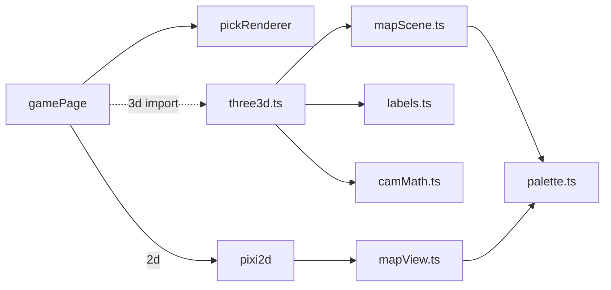

# Requirements

### Overview & Goals
Phase 4 of the optional 3D renderer: a three.js `GameRenderer` that draws the **static map** (floor, grid, spawn zones, sites, extruded walls, labels) with the phase 3 camera. It is loaded lazily, only when `pickRenderer` returns `"3d"`. The default 2D game stays byte-for-byte the same.

### Scope
**In scope**
- `web/src/render/palette.ts`: a pure palette module shared by 2D and 3D.
- `web/src/render/three3d/mapScene.ts`: the static scene builder and `disposeMapScene`.
- `web/src/render/three3d/labels.ts`: the browser CanvasTexture label factory.
- `web/src/render/three3d/three3d.ts`: `Three3dRenderer` and `createThree3dRenderer`.
- `gamePage.ts`: lazy `import()` of the 3D renderer, with one warn and a fallback to 2D.
- Tests: new `mapScene.test.ts`, plus extensions to `camMath.test.ts` and `three-lazy.test.ts`.
- Docs: a "Phase 4 — static map" section in `docs/3d-renderer.md`.

**Out of scope**
- Actors and tracers (phase 5).
- Multi-panel replay (phase 6): only `panels[0]` is rendered, into the whole canvas.
- Shadows (phase 7).
- CHANGELOG entry (phase 8).
- Any change to `sim/`, `session.ts`, scoring, kiosk, touch, level code, `probe.ts` or the `?3d` probe in `main.ts`.
- New dependencies or three/examples addons (none needed; see Technical Design).

### Functional Requirements
- `/?3d=1` with WebGL2 shows a tilted map with walls, sites and readable labels.
- The round plays and finishes with the same score card as 2D. The sim does not depend on the renderer.
- Mouse aim works in 3D: `screenToWorld` returns the ground point under the cursor, or `null` outside `[0,w]x[0,h]`. `Controls` is unchanged.
- If WebGL2 is missing, `pickRenderer` already returns 2D. If the 3D import or WebGL init throws, there is exactly one `console.warn`, then the 2D renderer is used.
- The 2D path (`/?auto&seed=42`) is unchanged: 500 points, 3.7 s / 6.0 s, 2/3 kills.

### Non-Functional Requirements
- Entry chunk gzip grows by at most ~1.5 kB. All three.js code stays in lazy chunks.
- No CSP impact: no eval, no workers, no remote fonts or textures. Labels use locally loaded fonts drawn onto a canvas.
- English only. Deterministic sim is untouched.

# Technical Design

### Current Implementation
- `render/renderer.ts` defines the `GameRenderer` seam.
- `render/pixi2d.ts` is the 2D reference. It uses `renderResolution` from `game/input.ts`, which caps resolution at 2.
- `render/mapView.ts` L8-13 hold the palette constants and L72-129 `drawMap`. The spawn label size (`spawnLabelSize`, 150; minimum 10 CSS px) also lives here.
- `three3d/camMath.ts`: world (x, y) maps to (X=x, Y=0, Z=y). The camera sits on +Z looking toward -Z, which matches `PerspectiveCamera.lookAt` with up = +Y.
- `gamePage.ts`:
  - L151-152 computes `rendererPick` and only logs it.
  - L164 runs `ensureFonts()`.
  - L168 always awaits `createPixi2dRenderer({width: size, height: size})`.
  - L360-361 (live) and L490-491 (replay) call `loadMap` and `setPanels`.

### Key Decisions
1. **Axis flip.** Rotation about X by -90° maps (x, y, z) to (x, z, -y). So a Shape point (x, y) would land at (x, 0, -y), which is mirrored, while extrusion depth (+Z) correctly becomes +Y (up).
   - Fix: build every `Shape` from **(x, -y)**, then call `geometry.rotateX(-Math.PI / 2)`. A point then lands at (x, 0, y) and walls rise along +Y.
   - three's Shape/Extrude code fixes the winding itself.
   - The test asserts that a wall vertex at world (x, y) appears at (x, *, y).
   - One helper, `shapeFromPolygon(poly)`, is used for walls, sites and spawns.
2. **Dashed outlines: pre-split segments.** A dash helper ported from `dashedPoly` (dash/gap in world cm: 120/90 for spawns, 160/110 for sites) feeds `LineSegments` with a `LineBasicMaterial`.
   - It reproduces the 2D dash pattern exactly.
   - It needs no `computeLineDistances` call and is easy to test.
3. **Line width.** WebGL lines are always 1 px, and wide lines would need the `Line2` addon, so it is not used.
   - 3D lines are therefore thin. Site corner brackets use the bracket colour/alpha (amber 0.9).
   - The 2D 70 cm wall halo is omitted; the cyan `EdgesGeometry` stands in for it.
   - Both gaps are recorded in the parity note.
4. **Walls: one mesh per wall, shared materials.**
   - One `ExtrudeGeometry({depth: WALL_HEIGHT, bevelEnabled: false})` per polygon, all sharing one `MeshLambertMaterial(WALL_FILL)`.
   - Each wall gets `EdgesGeometry` → `LineSegments` sharing one `LineBasicMaterial(cyan, opacity 0.55)`.
   - Merging would need the `BufferGeometryUtils` addon, so it is skipped. Kiln/Cistern wall counts are small.
5. **Labels.** `makeLabel(text, style)` is injected.
   - `style = {font, sizeWorld, color, alpha, letterSpacing?}`.
   - The factory returns a plane in XY (text up = +Y), sized in world units, or `null`.
   - `mapScene` rotates it -90° about X, so text-up points to -Z (screen up), and places it at `polygonCentroid` at Y = 3.
   - Site letters use `DISPLAY_FONT` 380, amber, alpha 0.55.
   - Spawn labels use `MONO_FONT`, `spawnLabelSize(cssPxPerUnit)`, letterSpacing 0.12·size, tint colour, alpha 0.7.
6. **Keep mapScene free of Pixi.** Along with the palette constants, `SITE_LABEL_SIZE`, `SPAWN_LABEL_SIZE`, `MIN_LABEL_CSS_PX` and `spawnLabelSize` move into `palette.ts`.
   - `mapView.ts` re-exports `spawnLabelSize`, so existing imports keep working.
   - This is a small extension of item 1 in your brief. It keeps the lazy chunk and the vitest run free of `pixi.js`.
7. **Fallback.** Any throw from the import, `WebGLRenderer` construction (three r187 throws without WebGL2) or the first resize triggers one `console.warn("[renderer] 3D unavailable, falling back to 2D", err)` and then `createPixi2dRenderer`.
   - The 2D branch keeps the existing single `await createPixi2dRenderer(...)` call, so its timing does not change.

### Data Models / Contracts
```ts
// render/palette.ts (pure: imports only ui/theme)
export const FLOOR = 0x070b10, GRID_MINOR = 400, GRID_MAJOR = 2000, WALL_FILL = 0x111b25;
export const ATTACK_TINT = THEME_NUM.red, DEFENSE_TINT = THEME_NUM.green;
export const SITE_LABEL_SIZE = 380; export function spawnLabelSize(cssPxPerUnit?: number): number;

// render/three3d/mapScene.ts
export const WALL_HEIGHT = 240;
export type LabelStyle = { font: string; sizeWorld: number; color: number; alpha: number; letterSpacing?: number };
export type MakeLabel = (text: string, style: LabelStyle) => THREE.Object3D | null;
export function buildMapScene(map: MapDef, opts?: { makeLabel?: MakeLabel; cssPxPerUnit?: number }): THREE.Group; // name "map"
export function disposeMapScene(group: THREE.Object3D): void; // geometries, materials (+ map textures)

// render/three3d/labels.ts (browser only)
export const makeCanvasLabel: MakeLabel; // 2D canvas -> CanvasTexture(sRGB) -> transparent MeshBasicMaterial plane

// render/three3d/three3d.ts
export class Three3dRenderer implements GameRenderer { readonly kind = "3d"; /* ... */ }
export async function createThree3dRenderer(opts: { width: number; height: number }): Promise<Three3dRenderer>;
```

### Scene Layout (Group "map")
- **Floor:** `PlaneGeometry(w, h)`, `rotateX(-π/2)`, translated to (w/2, 0, h/2). `MeshBasicMaterial(FLOOR)`.
- **Grid** at Y = 1, two `LineSegments`:
  - minor: every 400, `THEME_NUM.line`, opacity 0.45;
  - major: every 2000, `lineHi`, opacity 0.4.
- **Spawns and sites** at Y = 2:
  - `ShapeGeometry` fills: tint 0.07 (spawns) / amber 0.08 (sites), `transparent`, `depthWrite: false`.
  - Dashed outlines: spawn tint 0.45, site amber 0.5.
  - Site corner brackets: amber 0.9.
- **Walls:** extruded meshes from Y = 0 to `WALL_HEIGHT`, plus edge lines.
- **Lights:** `HemisphereLight` plus one `DirectionalLight` from above and in front, no shadows. Only the Lambert walls respond to light; the floor, fills and lines stay unlit so their colours match the palette.
- `renderOrder` keeps the transparent fills drawn after the floor and grid.

### Three3dRenderer
- **Constructor:**
  - `WebGLRenderer({antialias: true, powerPreference: "high-performance"})`.
  - `setPixelRatio(renderResolution(devicePixelRatio))`, `setClearColor(THEME_NUM.bg)`, `outputColorSpace = SRGBColorSpace`.
  - Sets the initial size from opts.
- **`resize(cssW, cssH)`:** calls `setSize(cssW, cssH)` (updates the CSS style, like Pixi's autoDensity), then `updateCamera()`.
- **`updateCamera()`:** `fit = fitCamera({minX:0,minY:0,maxX:w,maxY:h}, cssW/cssH)`, then copies position, `lookAt(target)`, fov, aspect, near and far, and calls `updateProjectionMatrix`.
- **`loadMap(map, opts)`:** disposes and removes the old group, then adds `buildMapScene(map, {makeLabel: makeCanvasLabel, cssPxPerUnit})`.
- **`setPanels(specs)`:** stores the specs. This phase uses the whole canvas for `panels[0]`.
- **`draw(frames)`:** calls `renderer.render(scene, camera)` once and ignores actors.
- **`screenToWorld(clientX, clientY)`:** `ndcFromClient(..., canvas.getBoundingClientRect())` → `groundPoint(fit, ndc)` → `null` if it misses or falls outside `[0,w]x[0,h]`.
- **`destroy()`:** `disposeMapScene`, `renderer.dispose()`, `forceContextLoss()`, `canvas.remove()`.

### gamePage.ts change (L150-152, L168)
```ts
const rendererPick = pickRenderer(location.search, detectCaps());
...
const renderer: GameRenderer =
  rendererPick.kind === "3d" ? await create3dOr2d(size) : await createPixi2dRenderer({ width: size, height: size });
// create3dOr2d: try { (await import("../render/three3d/three3d")).createThree3dRenderer(...) } catch { warn once; pixi }
```
The phase 3 `console.info` is removed. `main.ts` and `probe.ts` are untouched.

### File Structure
- `web/src/render/palette.ts` (new)
- `web/src/render/mapView.ts` (modified: imports from palette and re-exports `spawnLabelSize`)
- `web/src/render/three3d/mapScene.ts`, `labels.ts`, `three3d.ts` (new)
- `web/src/game/gamePage.ts` (modified)
- `web/tests/mapScene.test.ts` (new); `camMath.test.ts` and `three-lazy.test.ts` (extended)
- `docs/3d-renderer.md` (appended)

### Architecture Diagram


### Risks
- **Colour management:** hex colours are treated as sRGB and output as sRGB, so unlit materials match the palette. Lambert walls will look darker or brighter than `WALL_FILL` depending on light intensity; that is acceptable.
- **Transparent fills z-fighting with the grid:** handled by the Y offsets (1 / 2 / 3 cm) plus `depthWrite: false`.
- **Canvas size vs. CSS scaling:** `getBoundingClientRect` in `screenToWorld` already accounts for CSS downscaling.
- **Chunk growth:** `three3d.ts` and three share one lazy chunk. The entry only gains the `import()` stub (well under 1.5 kB).

# Testing

### Validation Approach
- Run `npx tsc --noEmit`, `pnpm test`, `pnpm build:public` (must print "verify-dist: OK") and `uv run pytest` (sanity only).
- Report the entry and three chunk sizes, raw and gzip, against the phase 0 table.
- Run browser checks with headless Chrome (Playwright, via the webapp-testing skill) against `pnpm dev` at 1280x800.

### Test Changes
- **`tests/mapScene.test.ts`** (real Kiln map, no labels):
  - The floor bounding box is exactly X [0, w], Z [0, h], Y = 0.
  - Wall mesh count equals `map.walls.length`.
  - The union of wall bounding boxes spans Y from 0 to `WALL_HEIGHT`.
  - For the first wall vertex (x, y), the geometry contains (x, *, y) and not (x, *, -y) (when y ≠ 0).
  - Material colours: floor `FLOOR`, walls `WALL_FILL`, edges `THEME_NUM.cyan`, grid line/lineHi, spawns ATTACK/DEFENSE tint, sites amber. Compared via `color.getHex()`, plus opacity and transparent/depthWrite flags.
  - `disposeMapScene` calls `dispose` on every geometry and material (`vi.spyOn`).
  - A stub `makeLabel` adds four labels (site letters plus two spawn labels) at the centroids, at Y > 2.
- **`tests/camMath.test.ts`:**
  - Bounds 8000x3000 and 3000x8000 at aspect 1, 3 and 1/3 still fit tight: max corner |NDC| ≈ 1 − margin (within 1e-3), and every corner ≤ 1 − margin.
  - Independent checks without camMath helpers:
    - The pitch, `asin(-(target−pos).y / |target−pos|)`, equals `CAMERA_PITCH_DEG`.
    - A `THREE.PerspectiveCamera` built from the fit (position, lookAt, fov, aspect) projects the target to NDC (0, 0) and the corners to the same NDC as `project`.
- **`tests/three-lazy.test.ts`:**
  - Scan `src/**/*.ts`: only files under `src/render/three3d/` import `"three"`, whether statically or via `import("three")`.
  - `gamePage.ts` has no static import from `render/three3d/` and contains `import("../render/three3d/three3d")`.
  - The existing `main.ts` checks stay.

### Key Scenarios (browser)
- **2D parity:** `/?auto&seed=42` shows 500 points, 3.7 s / 6.0 s, 2/3 kills.
- **3D:** `/?3d=1&auto&seed=42` shows the tilted map with walls, sites and labels, with no console errors and the same score card. Take a screenshot.
- **Aim:** with `/?3d=1&fps`, move the mouse to several points and check that `__rtr` `aimWorld` follows the ground point under the cursor (compare against `screenToWorld`).

### Edge Cases
- `detectCaps` stubbed false, or Chrome started with `--disable-webgl2`: the 2D renderer is used. Verify no errors and at most the one warn.
- Forced 3D init failure (e.g. `getContext` stubbed to return null): exactly one warn, then 2D, and the game plays.
- The replay screen in 3D still works (it shows `panels[0]` only) and `destroy` leaves no extra canvas behind.

# Delivery Steps

### ✓ Step 1: Extract the shared palette
The map palette lives in `render/palette.ts`, and the 2D output is unchanged.

- Create `web/src/render/palette.ts`:
  - `FLOOR`, `GRID_MINOR`, `GRID_MAJOR`, `WALL_FILL`, `ATTACK_TINT`, `DEFENSE_TINT`;
  - label constants and `spawnLabelSize`.
  - Its only import is `ui/theme`.
- Update `mapView.ts` to import from it and re-export `spawnLabelSize`; the drawing code is unchanged.
- Run `tsc` and `pnpm test` to confirm existing 2D tests pass.

### ✓ Step 2: Build the static 3D map scene with tests
`buildMapScene` and `disposeMapScene` produce a correctly oriented three.js map, verified by `mapScene.test.ts`.

- Add `three3d/mapScene.ts`:
  - `WALL_HEIGHT = 240`;
  - a `shapeFromPolygon` helper using (x, -y) plus `rotateX(-π/2)`;
  - floor, minor/major grid `LineSegments`, spawn and site fills, pre-split dashed outlines and brackets;
  - per-wall `ExtrudeGeometry` with shared Lambert material, plus `EdgesGeometry` cyan lines;
  - hemisphere and directional lights;
  - optional injected labels at centroids.
- Add `disposeMapScene` (geometries, materials, textures).
- Add `web/tests/mapScene.test.ts`: bounds, wall count and height, axis sign, palette colours, dispose spies, stub labels.

### ✓ Step 3: Implement Three3dRenderer and the canvas label factory
`Three3dRenderer` implements `GameRenderer` and renders the map with the fitted camera and working `screenToWorld`.

- Add `three3d/labels.ts`: `makeCanvasLabel` draws `DISPLAY_FONT`/`MONO_FONT` text onto a canvas, turns it into a `CanvasTexture` (sRGB) and returns a transparent plane sized in world units.
- Add `three3d/three3d.ts` with the `WebGLRenderer` settings from your brief. It covers:
  - `resize` and `fitCamera` with a `PerspectiveCamera`;
  - `loadMap` rebuild with dispose;
  - `setPanels` storing specs, and `draw` rendering once;
  - `screenToWorld` via `ndcFromClient` and `groundPoint` with bounds check;
  - full `destroy`;
  - the `createThree3dRenderer` factory.
- Extend `camMath.test.ts`: non-square bounds, extreme aspects, independent pitch check, and a `THREE.PerspectiveCamera` cross-check that the target projects to NDC (0, 0).

### ✓ Step 4: Wire lazy 3D selection with fallback in gamePage
`/?3d=1` uses the 3D renderer through `import()`; any failure warns once and falls back to 2D, and the 2D path is unchanged.

- In `gamePage.ts`, replace the phase 3 log with the `rendererPick.kind === "3d"` branch: dynamic import plus `createThree3dRenderer`, and in the catch block one `console.warn` then `createPixi2dRenderer`.
- Leave the 2D branch as the same single await call.
- Extend `three-lazy.test.ts`: only `src/render/three3d/` imports `three`, and `gamePage` reaches `three3d.ts` only via `import()`.
- Run `tsc`, `pnpm test`, `pnpm build:public` (verify-dist OK) and record the entry and three chunk sizes, raw and gzip.

### ✓ Step 5: Browser verification and docs
2D parity, the 3D smoke run, aim and fallback are verified in headless Chrome, and `docs/3d-renderer.md` has the phase 4 notes.

- 2D: `/?auto&seed=42` score card shows 500 points, 3.7 s / 6.0 s, 2/3 kills.
- 3D at 1280x800: `/?3d=1&auto&seed=42` shows the tilted map with no console errors and the same score card. Take a screenshot.
- Aim: `/?3d=1&fps` with `__rtr` `aimWorld` following the cursor's ground point.
- Fallback: WebGL2 disabled or caps stubbed means 2D with at most one warn.
- Append "Phase 4 — static map" to `docs/3d-renderer.md`:
  - scene layout and Y offsets, the axis flip, `WALL_HEIGHT`, and the fallback rule;
  - chunk sizes;
  - what is missing: actors, multi-panel, shadows;
  - the parity note: 1 px lines, no wall halo, lit walls.
- No CHANGELOG entry and no commit.