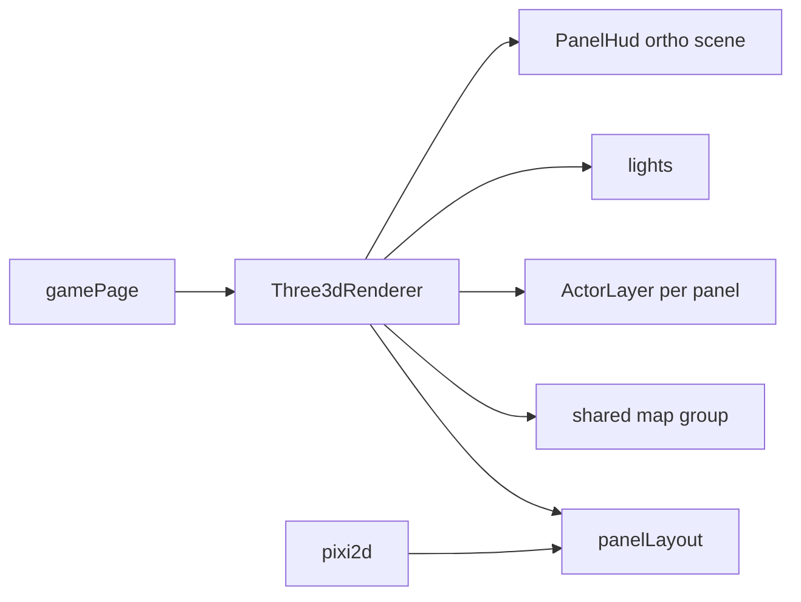

# Requirements

### Overview & Goals
Phase 6 of the optional 3D renderer: `Three3dRenderer` honours every `PanelSpec`. Each panel gets its own scissor viewport in the single WebGL canvas, its own camera fit and its own `ActorLayer`, plus the YOU / PRO header plates, so the 3D replay screen matches the 2D one. The default 2D game does not change at all.

### Scope
**In scope**
- New pure `web/src/render/panelLayout.ts` (`HEADER_H`, `fieldRect`, `glViewport`, `panelAt`). `pixi2d.ts` reuses it and its output stays identical.
- Rendering multiple panels in `three3d.ts`, `screenToWorld` per panel, and moving the lights into the renderer scene.
- New `web/src/render/three3d/panelHud.ts` header overlay.
- `actorScene.ts` NITs: bound methods instead of per-update closures, and a progress above 0 shows at least 1 segment.
- Tests and the docs update in `docs/3d-renderer.md`.

**Out of scope**
- `gamePage.ts`: no change is needed. The live view is already `setPanels([{x:0,y:0,size}])` on a size×size canvas, and the replay calls resize → loadMap → setPanels.
- `sim/`, `session.ts`, `frameView.ts`, `replayPlayer.ts`, `replayModel.ts`, scoring, kiosk, touch, level code and the phase 0 probe.
- CSP, CHANGELOG (phase 8), new dependencies.

### Functional Requirements
- The 3D replay shows YOU and PRO side by side at 1280x800 and stacked at 800x1200. Each has a header plate (surface fill, 10 px bevel, 4 px accent bar, 1 px line stroke), the title in DISPLAY_FONT 18 px with letter spacing 3 at (16, 5) in the accent colour, and the note in MONO_FONT 11 px, uppercase, textDim, at title right + 12 and y 10. The note is hidden when `x + w > size - 8`.
- For 2D parity the HUD also draws the thin lineHi field frame and the 18 px accent corner tick that pixi2d draws for titled panels.
- Both fields animate independently. Play, pause, scrub and speed work. Closing the replay returns to the single live view, which looks exactly like phase 5.
- `screenToWorld` returns the ground point under the cursor in the hovered field. It returns null over headers, gaps, outside the map, and when no map is loaded.
- `/?auto&seed=42` (2D) and `/?3d=1&auto&seed=42` both give 500 points, 3.7 s / 6.0 s, 2/3 kills.

### Non-Functional Requirements
- Entry chunk gzip grows by at most ~0.5 kB. `panelLayout.ts` is tiny, and three stays in the lazy chunks. Only files under `render/three3d/` import three.
- No per-frame allocation of geometries, materials, textures, cameras or viewport objects.
- English only, no new dependencies.

# Technical Design

### Current Implementation
- `three3d.ts`: one `ActorLayer`, a single fit `fitCamera(bounds, cssW/cssH)`, and `draw` renders `frames[0]` over the whole canvas. `setPanels` only stores the specs.
- `pixi2d.ts`: has a private `HEADER_H = 32` and `fieldOrigin(p)`. `screenToWorld` loops over the specs, using a square field of size `spec.size`.
- `mapScene.ts` ~:190 adds `hemi-light` and `sun-light` to the map root. The sun is placed from the map w/h. `mapScene.test.ts` ~:129-130 finds both lights in the map scene.
- `actorScene.ts` `update` :173-175 passes new arrow closures to `fill` on every call. `setProgress` :329 uses `Math.round(frac*RING_SEGMENTS)`, which gives 0 segments for 0.001.

### Key Decisions
- **One shared map group, N actor layers.** The map is drawn once per viewport. Each layer owns its geometry because `setProgress` and `setPulseRadius` mutate buffers. All layers live in the scene, and only layer i is visible while panel i renders.
- **Square fit per panel:** `fitCamera(bounds, 1)`, cached as `fits[i]` and recomputed on resize, loadMap and setPanels. With no panels, fall back to one whole-canvas pass with aspect `cssW/cssH` (phase 5 behaviour). The live panel `{0,0,size}` on a size×size canvas gives aspect 1, so the view is the same as phase 5.
- **One shared camera:** `PerspectiveCamera` is re-posed from the cached fit for each panel, with no new cameras. `applyFit(cam, fit)` is factored out of `updateCamera`.
- **HUD as a separate ortho scene** in CSS px (`OrthographicCamera(0, cssW, 0, -cssH)`, y down via negated y). It is rendered last over the full viewport with the scissor test off. It is rebuilt only on setPanels and resize.
- **Lights:** a new `createLights()` / `placeLights(lights, w, h)` in `three3d/lights.ts` builds the same hemi and sun lights. The renderer adds them to its scene in the constructor and calls `placeLights` on loadMap. The HUD uses unlit `MeshBasicMaterial`, so the lights do not affect it.

### Data Models / Contracts
```ts
// web/src/render/panelLayout.ts (pure)
export const HEADER_H = 32;
export interface Rect { x: number; y: number; w: number; h: number }
export function fieldRect(spec: PanelSpec): Rect;          // {x, y + (title? HEADER_H:0), size, size}
export function glViewport(r: Rect, cssH: number): Rect;   // {x, cssH - r.y - r.h, w, h}
export function panelAt(specs: readonly PanelSpec[], px: number, py: number): number; // -1 if none

// web/src/render/three3d/panelHud.ts
export class PanelHud {
  readonly scene: THREE.Scene; readonly camera: THREE.OrthographicCamera;
  rebuild(specs: readonly PanelSpec[], cssW: number, cssH: number, pixelRatio: number): void; // disposes previous
  get isEmpty(): boolean;   // no titled panels -> skip the HUD render
  dispose(): void;
}
// optional injectable text factory for tests: (spec, pixelRatio) => THREE.Texture | null
```
`panelAt` uses a half-open containment test (`x <= px < x+w`, `y <= py < y+h`), matching pixi2d's check. pixi2d's `fieldOrigin` becomes `{x, y} = fieldRect(p)`, so the 2D output stays identical.

### Proposed Changes
**three3d.ts**
- State: `layers: ActorLayer[]`, `fits: CameraFit[]`, `viewports: Rect[]` (GL px in CSS units; three applies the pixel ratio), `lights`, `hud`.
- `setPanels`: grow or shrink the layers (always keep at least 1, dispose extras and remove them from the scene). Then `updateFits()` and `hud.rebuild(...)`.
- `resize` and `loadMap`: `updateFits()`. `resize` also rebuilds the HUD.
- `draw(frames)`:
  - Set `autoClear = false`, `setScissorTest(false)`, `setViewport(0,0,cssW,cssH)`, then `clear()`.
  - For each panel i: set `layers[j].group.visible = j===i`, call `layers[i].update(frames[i] ?? null, now)`, `applyFit(camera, fits[i])`, `setViewport(vp)`, `setScissor(vp)`, `setScissorTest(true)`, then `render(scene, camera)`.
  - Then `setScissorTest(false)`, a full viewport, and `render(hud.scene, hud.camera)` when the HUD is not empty.
  - Finally show all layers again.
- `screenToWorld`:
  - Map the client point to CSS-logical px via the bounding rect and `cssW/rect.width`, so a CSS-scaled canvas works.
  - `i = panelAt(...)`; if it is -1, return null.
  - Build a client-space rect for the field (rect.left + field.x·sx, etc.) and call `ndcFromClient` with it, then `groundPoint(fits[i], ...)`. Map bounds check as today.
- `destroy`: dispose all layers, the HUD and the lights.

**panelHud.ts**
- For each titled panel, a group at (x, y):
  - Plate: `ShapeGeometry` of the bevelled polygon (w = size, h = HEADER_H-4, b = 10), surface `MeshBasicMaterial`, and a `LineLoop` lineHi... no, a `line` stroke as in 2D.
  - Accent bar: a 4×h plane.
  - Field frame and corner tick: `LineSegments` in lineHi and the accent colour.
  - Text plane: a `CanvasTexture` drawn at the device pixel ratio. Title: `700 18px DISPLAY_FONT`, letterSpacing 3 (per-character advance like `labels.ts`). Then the note with the overflow rule. sRGB colour space and `depthTest false`.
- Everything goes into an owned `Set` and is disposed on rebuild and dispose.

**actorScene.ts**
- Class-field arrows created once: `makeEnemyFn`, `setEnemyFn`, and the same pair for downs and tracers.
- `setProgress`: `segs = frac > 0 ? Math.max(1, Math.round(frac*RING_SEGMENTS)) : 0`.

**mapScene.ts**: remove the lights; the comment points to `lights.ts`.

### File Structure
- Add `web/src/render/panelLayout.ts`, `web/src/render/three3d/panelHud.ts`, `web/src/render/three3d/lights.ts`
- Modify `web/src/render/pixi2d.ts`, `three3d/three3d.ts`, `three3d/actorScene.ts`, `three3d/mapScene.ts`, `docs/3d-renderer.md`
- Tests: add `web/tests/panelLayout.test.ts`, `web/tests/panelHud.test.ts`; update `web/tests/mapScene.test.ts`, `web/tests/actorScene.test.ts`

### Architecture Diagram


### Risks
- **Scissor state leaks** (for example into the next `clear`): always reset the scissor test, viewport and visibility at the end of `draw`.
- **CSS units:** three's `setViewport`/`setScissor` take CSS px and multiply by the pixel ratio internally, so `glViewport` stays in CSS px.
- **Fonts:** the HUD text needs the fonts loaded. gamePage already awaits `ensureFonts()` before the renderer is used.
- **Note width measured with canvas `measureText` vs Pixi:** this could hide or show the note differently at the edge. The same font and spacing are used, and it is accepted as a parity note.

# Testing

### Validation Approach
Unit tests without WebGL, plus a full check run and headless Chrome runs on `pnpm dev`, using the webapp-testing / chrome-devtools tooling.

### Test Changes
- `panelLayout.test.ts`:
  - `fieldRect` with and without a title.
  - `glViewport(cssH 600, y 40 h 200) → y 360`.
  - `panelAt` against the real `ReplayPlayer.panels()` row (1280x800) and column (800x1200) layouts from `replayLayout`. Points inside each field return 0 and 1. Points in the gap, in a header, and outside return -1.
  - Source guard: `pixi2d.ts` imports `HEADER_H` from `./panelLayout` and declares no local `HEADER_H`.
- `panelHud.test.ts`:
  - [YOU, PRO] specs give two plates and two title textures, using an injected stub text factory (jsdom has no canvas 2D).
  - An untitled panel gives an empty HUD.
  - `rebuild` calls `dispose` on the previous geometries, materials and textures (vi.spyOn).
  - There is no draw-time code to test (the HUD is static).
- `actorScene.test.ts`:
  - Two layers updated with different frames keep independent player and enemy positions.
  - `defuse 0.001` gives a progress draw range of at least 6 indices (1 segment).
  - Repeated `update` calls do not create new closures. This is checked indirectly: the existing pool tests still pass.
- `mapScene.test.ts`: the map group contains no lights, and `createLights`/`placeLights` produce the named hemi and sun lights at the same positions.

### Key Scenarios
- Run `npx tsc --noEmit`, `pnpm test` and `pnpm build:public` (verify-dist: OK), and report the entry and three3d chunk sizes.
- 2D: `/?auto&seed=42` gives the score card 500 points, 3.7 s / 6.0 s, 2/3 kills. Take a replay screenshot.
- 3D: `/?3d=1&auto&seed=42` at 1280x800 and 800x1200 gives the same card, YOU and PRO with headers, and animating fields. Play, pause, scrub and speed work, closing returns to the live view, and there are no console errors. Take screenshots and report the `?fps` reading.
- `screenToWorld` probed via `page.evaluate` at field centres, headers and the gap.

# Delivery Steps

### ✓ Step 1: Shared panel layout module and pixi2d reuse
Panel geometry lives in one pure module, used by pixi2d with identical output.
- Add `web/src/render/panelLayout.ts` with `HEADER_H`, `Rect`, `fieldRect`, `glViewport` and `panelAt`.
- `pixi2d.ts`: drop the local `HEADER_H` and `fieldOrigin`, and use `fieldRect` in `rebuild` and `screenToWorld`.
- Add `web/tests/panelLayout.test.ts`:
  - the cases listed in the Testing tab;
  - real `ReplayPlayer.panels` row and column layouts;
  - the pixi2d source guard.
- Run tsc and the tests.

### ✓ Step 2: ActorLayer NITs and lights moved to the renderer
Actor updates no longer allocate closures, tiny defuse progress is visible, and the lights belong to the renderer scene.
- `actorScene.ts`:
  - class-field bound make/set functions used by `fill`;
  - `setProgress` shows at least 1 segment when frac > 0.
- Add `three3d/lights.ts` (`createLights`, `placeLights`) and remove the lights from `mapScene.ts`.
- `three3d.ts`: add the lights in the constructor and place them on loadMap.
- Update `mapScene.test.ts` (no lights in the map group, plus a lights helper test).
- Extend `actorScene.test.ts`:
  - two independent layers;
  - progress 0.001 gives at least 1 segment.

### ✓ Step 3: Per-panel scissor viewports and screenToWorld in Three3dRenderer
3D draws every panel in its own viewport with its own fit and actor layer, and picking works per field.
- `setPanels` grows or shrinks the `ActorLayer` pool (minimum 1, extras disposed).
- Cached `fits`/`viewports` recomputed on resize, loadMap and setPanels.
- The fallback with no panels keeps the phase 5 whole-canvas behaviour.
- `draw`:
  - clear once;
  - per panel: set layer visibility, update with `frames[i]`, apply the fit, set the viewport and scissor, render;
  - reset the scissor state;
  - no per-frame allocations.
- `screenToWorld` maps CSS px through `panelAt` and the per-field `ndcFromClient` rect, using `groundPoint` with `fits[i]`.
- `destroy` disposes all layers.

### ✓ Step 4: PanelHud header overlay
Titled panels show YOU / PRO header plates, the title and note, and the field frame, matching 2D.
- Add `three3d/panelHud.ts`:
  - an ortho CSS-px scene;
  - a bevelled surface plate with a line stroke, a 4 px accent bar, the field frame and corner tick;
  - a CanvasTexture for the title and note with pixi2d fonts, sizes and colours and the note overflow rule;
  - an owned-resource set, disposed on rebuild and dispose.
- `three3d.ts`:
  - rebuild the HUD on setPanels and resize;
  - render it after the panels at the full viewport with the scissor off, skipped when empty;
  - dispose it on destroy.
- Add `web/tests/panelHud.test.ts` (two plates and two textures, untitled gives nothing, rebuild disposes, using an injected text factory).

### * Step 5: Docs and end-to-end verification
Phase 6 is documented and verified in 2D and 3D.
- `docs/3d-renderer.md`: replace the phase 5 "Still missing" line and append "Phase 6 — replay viewports" covering:
  - the scissor flow and the y flip;
  - per-panel fits;
  - the HUD overlay;
  - the lights move;
  - parity notes and chunk sizes.
- Run `npx tsc --noEmit`, `pnpm test` and `pnpm build:public` (verify-dist: OK), and record the entry and three3d gzip sizes.
- Headless Chrome on `pnpm dev`:
  - 2D `/?auto&seed=42`: score card and replay screenshot;
  - 3D `/?3d=1&auto&seed=42` at 1280x800 and 800x1200: score card, screenshots, play/pause/scrub/speed, closing the replay, console errors, `?fps`;
  - `screenToWorld` probes over the fields, headers and gaps.
- No commit.