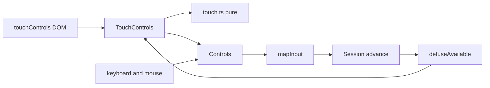

# Requirements

### Overview & Goals
Make a full round playable on a phone with touch only: a twin-stick overlay (move / aim+fire) and a hold-to-use DEFUSE button on the **play** screen. Desktop keyboard + mouse behaviour, the simulation, scoring, replay, kiosk and level code stay unchanged.

### Scope
**In scope**
- Detecting touch mode: `matchMedia("(pointer: coarse)")`, the first `PointerEvent` with `pointerType === "touch"`, or `?touch=1`.
- Left stick (move), right stick (aim + fire), DEFUSE button that appears only in range.
- Portrait layout (controls below the map) and landscape layout (translucent corner overlays).
- Blocking scroll and zoom while playing.
- Touch-specific hint and goal text.
- Pure helpers with Vitest tests.
- A `CHANGELOG.md` entry.

**Out of scope**
- Any change in `web/src/sim/`, scoring, replay, kiosk or level code.
- Touch redesign of menus or the score screen (they already work with taps).
- A touch "quit round" control (the round ends by itself).
- New dependencies.

### User Stories
- As a phone player, I want to move with my left thumb and aim/shoot with my right thumb at the same time, so I can fight like on desktop.
- As a defending phone player, I want a DEFUSE button when I stand on the planted spike, so I can win by defusing.
- As a desktop player, I want nothing to change.

### Functional Requirements
1. **Visibility.** The overlay shows only when `screen === "play"` and touch mode is on.
   - Touch mode starts on with `(pointer: coarse)` or `?touch=1`.
   - It turns on at the first touch pointer event.
   - It turns off on `keydown` or a mouse pointer event, unless `?touch=1` pins it on.
2. **Left stick (move).** Analog vector in the unit circle with dead zone 0.15. Values in between are rescaled so movement starts at 0 just outside the dead zone.
3. **Right stick (aim).**
   - Aim point = player position + direction × `AIM_REACH` (exported, 1500 cm).
   - Fires while the stick magnitude is > 0.7.
   - On release it keeps the last direction (the aim follows the player as they move) and stops firing.
4. **DEFUSE button.** Visible only when all of these hold: the clutcher is on defense, the spike is active (`clockAt`), and the distance to the spike is ≤ `DEFUSE_RADIUS` (imported from `sim/constants.ts`, not duplicated). Holding it sets `use = true`; releasing it or `pointercancel` clears it.
5. **Multi-touch.** Each stick and the button use `setPointerCapture` and track only their own `pointerId`, so two fingers can move and aim at once.
6. **Layout and size.**
   - Portrait phone: a row below the map, with the left stick, the DEFUSE button in the centre and the right stick.
   - Landscape phone (`orientation: landscape` and `max-height: 540px`): fixed bottom-left and bottom-right overlays with translucent backgrounds, and the map limited to the viewport height.
   - Every touch target is at least 56 CSS px.
   - Styling uses only `theme.css` tokens.
7. **No scroll or zoom.** `touch-action: none` and `user-select: none` on the play area and the controls; `-webkit-touch-callout: none` and `contextmenu` prevented on the controls.
8. **Hint text.**
   - On touch, `#countdownHint` = "Left stick move · Right stick aim/fire · Hold DEFUSE", and the defense goal says "hold DEFUSE" instead of "hold E".
   - On desktop, the current texts are kept verbatim.
9. **Merging input.** `mapInput` accepts optional touch overrides.
   - Keyboard move wins when it is non-zero.
   - `fire` and `use` are ORed.
   - A touch aim override replaces the mouse aim.
   - With no overrides the output is identical to today.

### Non-Functional Requirements
- Simulation stays deterministic and untouched. Analog move is already clamped by the sim.
- No inline scripts and no external URLs (CSP). No new dependencies.
- All text in English.

# Technical Design

### Current Implementation
- `web/src/game/input.ts`:
  - `RawControls { keys, aimPx, pointerDown }` goes through `mapInput(raw, scale)` to become a sim `Input`.
  - It also holds `clientToCanvas` and `blocksDefault`.
- `web/src/game/gamePage.ts`:
  - `class Controls` (lines 79-117) handles the keyboard and the canvas pointer.
  - `show()` (206) toggles screens through `hidden`.
  - `startLevel()` (293) sets `#hudGoal` ("hold E").
  - The ticker (727) calls `controls.read(scale)` and uses `controls.hasAimed` to decide whether to draw the aim.
- `web/index.html`: `#game` contains `#hud`, `#gameStage`, the overlays and `#countdown` / `#countdownHint`.
- `web/src/ui/theme.css`:
  - `#game` is a column flexbox; `#gameStage canvas` is CSS-shrunk with `max-width: 100%`.
  - `#game button` has a global button style, so the sticks will be `div`s with `role`/`aria-label` to avoid inheriting it.
- Sim defuse rule (`sim.ts:301-308`): defense side, spike active, not moving, not firing, `dist ≤ DEFUSE_RADIUS`. Autopilot and render already import `DEFUSE_RADIUS` from `sim/constants.ts`.

### Key Decisions
- **Pure core, thin DOM shell.** All math and mode logic lives in a new `web/src/game/touch.ts` and is unit-tested. The DOM pointer handling lives in a new `web/src/game/touchControls.ts`. This matches the `input.ts` / `kiosk.ts` split.
- **Aim is direction-based.** The last unit direction is stored, and `stickAim(player, dir, AIM_REACH)` is recomputed every frame. The aim stays valid while the player moves and after the stick is released.
- **Canvas touches don't fire while touch mode is on.** In `Controls`, canvas pointer events with `pointerType === "touch"` are ignored while touch mode is active, so a stray tap on the map doesn't shoot. Mouse/pen paths are unchanged.
- **`?touch=1` pins the overlay on.** Keyboard or mouse input won't hide it, so desktop testing works even with a real mouse.
- **Defuse visibility reuses sim exports** (`clockAt`, `simTimeAt`, `DEFUSE_RADIUS`, `dist`), read-only imports with no new constants.

### Data Models / Contracts
```ts
// web/src/game/touch.ts
export const STICK_DEAD_ZONE = 0.15;
export const FIRE_THRESHOLD = 0.7;
export const AIM_REACH = 1500; // cm
/** Finger offset (px) → vector in the unit circle; |v| < deadZone → {0,0}; rescaled outside it. */
export function stickVector(dx: number, dy: number, radius: number, deadZone = STICK_DEAD_ZONE): Vec2;
/** World aim point = player + unit(dir) × reach; zero dir → player + (reach, 0)? no: returns null-safe player + {reach,0} only if dir is zero (callers never pass zero). */
export function stickAim(player: Vec2, dir: Vec2, reach = AIM_REACH): Vec2;
export type TouchModeEvent = "touch" | "mouse" | "pen" | "key";
export function nextTouchActive(active: boolean, ev: TouchModeEvent, forced: boolean): boolean;
export function defuseAvailable(world: World, s: SimState): boolean;
export function controlsHint(touch: boolean): string; // desktop = current #countdownHint text
export function goalText(side: "attack" | "defense", touch: boolean): string; // desktop = current strings

// web/src/game/input.ts (extended, backward compatible)
export type TouchOverrides = { readonly move?: Vec2; readonly aim?: Vec2; readonly fire?: boolean; readonly use?: boolean };
export type RawControls = { keys; aimPx; pointerDown; readonly touch?: TouchOverrides };
// mapInput: keyboard move if non-zero else touch.move ?? 0; aim = touch.aim ?? aimPx/scale;
// fire = pointerDown || Space || touch.fire; use = KeyE || touch.use.
```
`stickAim` with a zero direction is never called: `TouchControls` only stores non-zero directions, and before the first aim it provides no aim override.

### Components
- **`TouchControls`** (`web/src/game/touchControls.ts`) — a class built from the `#touchControls` root.
  - State per stick: `pointerId`, base centre, current vector. `lastAimDir: Vec2 | null`, `defuseHeld`, `active`.
  - Handles `pointerdown` (with `preventDefault` and `setPointerCapture`) and `pointermove` / `pointerup` / `pointercancel` / `lostpointercapture`, filtered by `pointerId`. It moves the knob with `transform`.
  - `overrides(player: Vec2): TouchOverrides | undefined` returns `undefined` when inactive or idle, so `mapInput` behaves exactly as before.
  - `setVisible(boolean)`, `setDefuseVisible(boolean)`, `reset()` (on screen change and `blur`), and an `onModeChange` callback.
- **`Controls`** (`gamePage.ts`)
  - Gets a `TouchControls` instance.
  - `read(scale, player)` passes `touch: touchControls.overrides(player)`.
  - `hasAimed` becomes true once a touch aim exists.
  - Ignores canvas touch pointers while touch mode is active.
- **`gamePage.ts` wiring**
  - Global capture listeners (`pointerdown` with `pointerType`, `keydown`) feed `nextTouchActive`.
  - `show()` and mode changes set overlay visibility, `#countdownHint` (`controlsHint`) and `#hudGoal` (`goalText`).
  - The ticker calls `touchControls.setDefuseVisible(defuseAvailable(world, s))`.
  - Desktop texts move into `touch.ts` unchanged.

### File Structure
- `web/src/game/touch.ts` — **new**, pure helpers.
- `web/src/game/touchControls.ts` — **new**, DOM twin-stick class.
- `web/src/game/input.ts` — **modified**: `TouchOverrides`, merging in `mapInput`.
- `web/src/game/gamePage.ts` — **modified**: wiring, hint/goal text.
- `web/index.html` — **modified**: `#touchControls` markup after `#gameStage`, containing `.stick[data-stick=move]`, `#touchDefuse` and `.stick[data-stick=aim]`, each with a `.knob`, `hidden` by default.
- `web/src/ui/theme.css` — **modified**: touch control styles, portrait/landscape media queries, `touch-action` rules.
- `web/tests/touch.test.ts` — **new**.
- `CHANGELOG.md` — **modified**: Unreleased / Added.

### Architecture Diagram

The overlay feeds touch overrides into `Controls`, and `mapInput` merges them with keyboard/mouse into the unchanged sim `Input`. Each frame, `defuseAvailable(state)` decides whether the DEFUSE button is visible.

### Risks
- **Defusing needs the clutcher to stand still** (sim rule). The dead zone guarantees zero move when the left stick is released. The DEFUSE button sits apart from the sticks.
- **Landscape phones:** the 480 px canvas is taller than the viewport. This is mitigated by `max-height` on the canvas in the landscape media query (aspect ratio kept, so `clientToCanvas` mouse mapping is still correct).
- **iOS double-tap zoom and long-press callout:** handled with `touch-action: none`, `-webkit-touch-callout: none`, `preventDefault` on `pointerdown` and `contextmenu`.
- **Kiosk capture listeners** act only on menu screens, so there is no interaction with the overlay.

# Testing

### Validation Approach
Unit-test the pure logic in `web/tests/touch.test.ts`. Run the full suite, the type check and the public build. Then play a full round in a browser with Playwright using a mobile viewport with touch (iPhone 12 Pro, 390x844) and `?touch=1&level=…`, following the webapp-testing skill.

### Key Scenarios
- `stickVector`:
  - inside the dead zone → `{0,0}`
  - at the radius → unit length
  - beyond the radius → clamped to 1
  - diagonal → stays inside the unit circle
  - just above the dead zone → near 0 (rescaled)
- `stickAim`: player + unit(dir) × reach for non-normalised directions; `AIM_REACH` is exported and > 0.
- `mapInput`:
  - without `touch` → identical to the current results (existing `display.test.ts` cases)
  - touch move used when no keys are held; keyboard move wins when both are present
  - touch aim overrides mouse aim
  - `fire` / `use` are ORed
- `nextTouchActive`: touch turns it on; mouse/key turn it off; `forced` stays on.
- `defuseAvailable` (synthetic fixture world as in `tests/game.test.ts`):
  - true inside `DEFUSE_RADIUS` on defense with the spike active
  - false outside the radius, on attack, or before the plant
- `controlsHint` / `goalText`: the desktop strings equal the current texts; the touch strings mention DEFUSE and not "E".
- Browser run with `?touch=1`:
  - the overlay is visible only on play
  - drag the left stick → the player moves
  - drag the right stick past 0.7 → tracers and an enemy hit
  - walk to the spike → DEFUSE appears; hold it → defuse completes
  - the score screen is reached

### Edge Cases
- Two simultaneous pointers (move + aim) are tracked independently.
- `pointercancel` resets the stick and DEFUSE.
- Releasing the right stick keeps the aim direction and stops fire.
- Desktop without `?touch=1`: the overlay stays hidden; mouse aim and click fire work as before.
- Screen change mid-drag (round ends) → the controls reset and are hidden.

### Test Changes
- New `web/tests/touch.test.ts`.
- `display.test.ts` and `kiosk.test.ts` stay unchanged and must pass.
- Done when `pnpm test`, `npx tsc --noEmit` and `pnpm build:public` ("verify-dist: OK") all pass.

# Delivery Steps

### ✓ Step 1: Add pure touch helpers and extend mapInput with tests
Stick math, touch-mode logic, defuse visibility, hint texts and the extended `mapInput` exist and are covered by `web/tests/touch.test.ts`.

- Create `web/src/game/touch.ts`:
  - constants `STICK_DEAD_ZONE` (0.15), `FIRE_THRESHOLD` (0.7), `AIM_REACH` (1500 cm)
  - functions `stickVector`, `stickAim`, `nextTouchActive`, `defuseAvailable` (imports `clockAt`, `simTimeAt`, `DEFUSE_RADIUS`, `dist` from sim; sim itself is not edited), `controlsHint`, `goalText` (desktop strings copied verbatim from the current code)
- Extend `web/src/game/input.ts`:
  - add `TouchOverrides` and an optional `RawControls.touch`
  - merge rules: keyboard move wins when non-zero; touch aim overrides; `fire`/`use` ORed
  - no output change without overrides
- Write `web/tests/touch.test.ts` covering the dead zone, clamping, rescaling, aim reach, mapInput merging, mode transitions, defuse range (synthetic fixture world) and hint texts.
- Run `pnpm test` and `npx tsc --noEmit`.

### ✓ Step 2: Build the TouchControls overlay markup, styles and pointer handling
A self-contained `#touchControls` overlay with two multi-touch sticks and a DEFUSE button exists, styled for portrait and landscape phones.

- Add the `#touchControls` markup to `web/index.html` after `#gameStage`:
  - left stick, `#touchDefuse`, right stick, each with a knob and `aria-label`
  - `hidden` by default
- Create `web/src/game/touchControls.ts` with class `TouchControls`:
  - per-stick `pointerId` tracking with `setPointerCapture`
  - `preventDefault` on `pointerdown`
  - `pointercancel` / `lostpointercapture` reset
  - knob transform
  - `lastAimDir` memory
  - `defuseHeld`
  - methods `overrides(player)`, `setVisible`, `setDefuseVisible`, `reset`
- Add styles in `web/src/ui/theme.css` using the existing tokens (`--surface`, `--line-hi`, `--cyan`, `--cyan-soft`, `--amber`, `--cut`, spacing):
  - targets ≥ 56 px
  - portrait row below the map
  - landscape (`orientation: landscape` and `max-height: 540px`) fixed translucent corner overlays, with the canvas `max-height` capped to the viewport
  - `touch-action: none`, `user-select: none`, `-webkit-touch-callout: none` on the controls and on `#game[data-screen="play"]`

### ✓ Step 3: Wire touch mode into gamePage and update hints
On the play screen, touch input drives the sim, the DEFUSE button follows spike range, and hints switch between touch and desktop text. Desktop behaviour is unchanged.

- In `web/src/game/gamePage.ts`, create `TouchControls`:
  - initial mode from `matchMedia("(pointer: coarse)")` or `?touch=1` (forced)
  - global capture `pointerdown`/`keydown` listeners feed `nextTouchActive`
- `Controls`:
  - `read(scale, player)` passes `touch` overrides
  - `hasAimed` is set by touch aim
  - canvas pointer events with `pointerType === "touch"` are ignored while touch mode is active
- `show()` and mode changes:
  - toggle overlay visibility (play only) and reset sticks off-play and on `blur`
  - set `#countdownHint` via `controlsHint`
  - set `#hudGoal` via `goalText` in `startLevel`
- Ticker: `setDefuseVisible(defuseAvailable(world, s))` each frame during play.
- Add an `Unreleased / Added` entry to `CHANGELOG.md`.

### ✓ Step 4: Verify the full touch round and the build
All checks pass and a full touch-only round is confirmed in a mobile-emulated browser.

- Run `cd web && pnpm test`, `npx tsc --noEmit` and `pnpm build:public` (expect "verify-dist: OK").
- Using the webapp-testing skill (Playwright, iPhone 12 Pro viewport with touch, dev server on port 5177, `?touch=1&level=<defense level>`):
  - drag the left stick to move
  - drag the right stick past 0.7 to shoot an enemy
  - walk to the spike and hold DEFUSE until the defuse completes
  - assert the score screen via the dev-only `window.__rtr`
  - take screenshots in portrait and landscape
- Check that desktop without `?touch=1` shows no overlay and the original hint text.
- Fix any layout or interaction issues found.